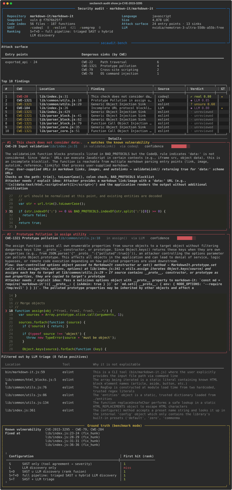
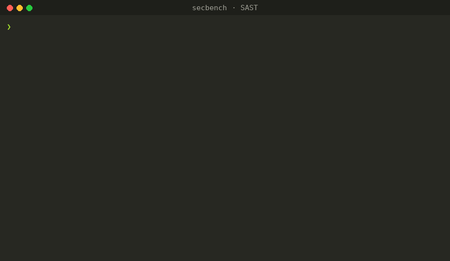
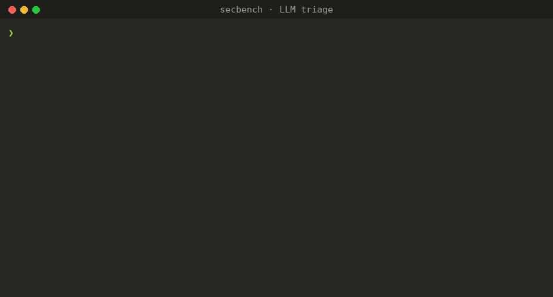
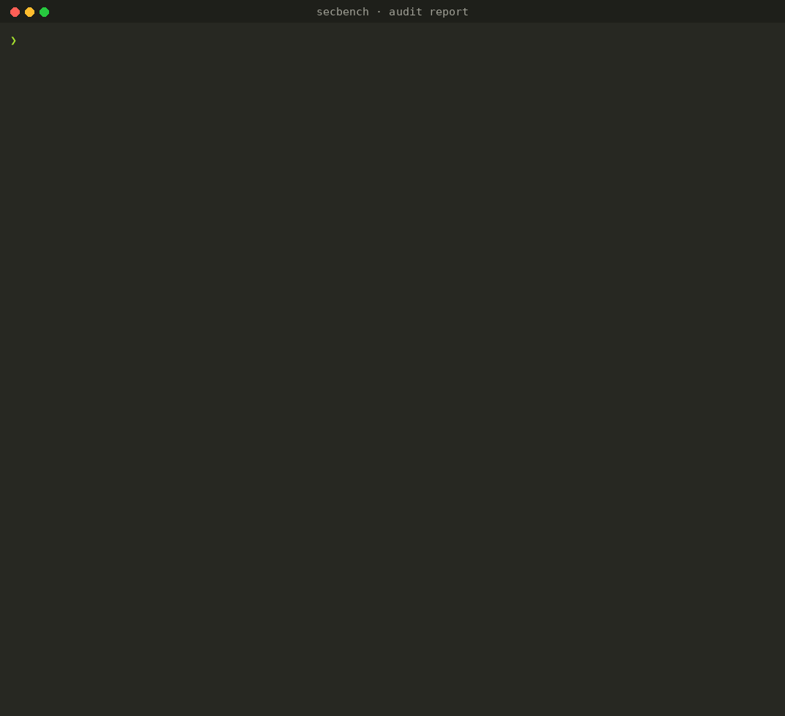
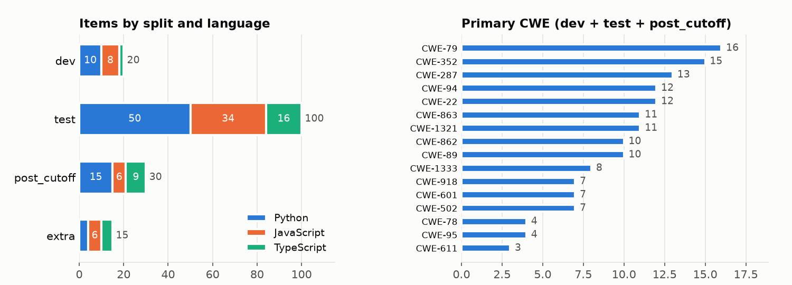

# Аудитор кода — монорепозиторий

**Автоматическая документация безопасности кода для аудита — и бенчмарк, который показывает, насколько она хороша.**

Полный конвейер анализа репозиториев: веб-фронтенд приёма заявок, продюсер-воркер и анализатор.
Анализатор берёт репозиторий на Python или JavaScript/TypeScript и пишет документ, который хотел бы
получить специалист по безопасности: четыре статических анализатора находят кандидатов, LLM проверяет их
и ищет то, что анализаторы пропустили, а на выходе — ранжированный список находок. У каждой находки есть
объяснение, поток данных source → sink, проверки, уже стоящие на пути, и значимый фрагмент кода.
Дополнительно формируется черновик документации по требованиям ФСТЭК.

Чтобы измерить, хорош ли этот документ, в репозиторий входит бенчмарк из **165 реальных CVE** с известными
местами исправления, и каждая конфигурация анализатора оценивается на нём.

Связь между сервисами — **только файловый контракт** через общее дерево `data/`, никакого прямого HTTP между ними нет.

```
Браузер ──HTTP──▶ WEB :8000 ──пишет──▶ data/uploads/{id}/  +  data/queue/{id}.json
                                             │
WORKER ──поллинг queue/──▶ CLAIM (rename .claimed)
   │  вызывает библиотеку ANALYZATOR (IngestService → ScanOrchestrator):
   │    SAST: Bandit · Semgrep · ESLint-security · CodeQL (SARIF, слияние) + pip-audit
   │    контекст: индекс tree-sitter, граф вызовов, точки входа, опасные вызовы
   │    LLM (опционально): триаж находок + поиск уязвимостей → ранжирование
   │  GitHub-ссылки клонируются (git --depth 1)
   ▼
data/reports/{id}/  ◀──пишет WORKER──  manifest.json · summary.json · report.html · doc.html
                                             │
Браузер ◀──HTMX-поллинг /scan/{id}/body── WEB читает manifest/summary и раздаёт артефакты
```

<p align="center">
  
</p>

📄 **[Отчёт о проекте](docs/REPORT.md)**: как это работает, результаты, удачные и неудачные примеры.

- **Веб-фронтенд** (`frontend/`) — приём репозитория (zip / файлы / ссылка GitHub-GitLab),
  защита от zip-бомб на входе, страница статуса, просмотр и скачивание готовых артефактов.
  Подробнее: [`frontend/README.md`](frontend/README.md).
- **Воркер** (`worker/`) — продюсер: забирает задачи из `data/queue/`, запускает анализ,
  рендерит `report.html` (отчёт аудита) и `doc.html` (черновик ФСТЭК), пишет
  `summary.json` (donut-виджет) и `manifest.json` (этапы статуса).
- **Анализатор** (`app/`) — библиотека для воркера, самостоятельный HTTP-сервис
  (`/api/v1/...`) и CLI `python -m app`.
- **Бенчмарк** (`bench/`) — сборка набора CVE, прогоны стадий на снимках, оценка, CLI `python -m bench`.

---

## Содержание

- [Что делает анализатор](#что-делает-анализатор)
- [Быстрый старт](#быстрый-старт-без-docker-два-процесса)
- [Docker](#docker)
- [Файловый контракт](#файловый-контракт-единственная-точка-интеграции)
- [Анализатор: CLI](#анализатор-cli)
- [Анализатор: API](#анализатор-api)
- [Анализатор: языковые плагины и SAST](#языковые-плагины-и-sast)
- [Анализатор: ИИ-анализ](#ии-анализ)
- [Бенчмарк](#бенчмарк)
- [Исследовательский CLI](#исследовательский-cli-python--m-bench)
- [Конфигурация](#конфигурация)
- [Данные](#данные)
- [Структура](#структура)
- [Тесты](#тесты)
- [Благодарности](#благодарности)

---

## Что делает анализатор

| | |
|---|---|
| 🔎 **Статический анализ** | [Semgrep](https://semgrep.dev), [Bandit](https://github.com/PyCQA/bandit), [ESLint](https://eslint.org) с [eslint-plugin-security](https://github.com/eslint-community/eslint-plugin-security) и [CodeQL](https://codeql.github.com). SARIF нормализуется, дубликаты между инструментами сливаются; пути потока данных CodeQL сохраняются. Для Python дополнительно — [pip-audit](https://github.com/pypa/pip-audit) (уязвимые зависимости). |
| 🧭 **Контекст кода** | индекс функций [tree-sitter](https://tree-sitter.github.io), приблизительный граф вызовов, точки входа (маршруты Flask/Django/FastAPI, обработчики Express/Koa, экспортируемый API npm-пакетов, CLI) и каталог опасных вызовов с привязкой к [CWE](https://cwe.mitre.org). |
| 🤖 **LLM-триаж** | для каждого предупреждения SAST решает, эксплуатируемо ли оно: контролирует ли атакующий источник, есть ли санитизация, достижим ли sink? Ложные срабатывания отбрасываются, причина сохраняется. |
| 🕵️ **LLM-поиск** | ранжирует функции по поверхности атаки и просит модель назвать конкретные уязвимости с точными строками, с подсказками SAST или без них. |
| 📑 **Документ аудита** | `report.html` и `doc.html` в веб-интерфейсе; терминал, SVG или Markdown в CLI: поверхность атаки, ранжированные находки, вердикты, объяснения, подсвеченный код, отклонённые предупреждения. |
| 📊 **Бенчмарк и метрики** | recall@k, MRR, различение уязвимой и исправленной версии, нагрузка на аудитора, качество триажа, бутстрап-ДИ, тесты МакНемара. |

LLM — любой OpenAI-совместимый эндпоинт: [OpenRouter](https://openrouter.ai) (включая бесплатные модели), OpenAI,
локальный [vLLM](https://github.com/vllm-project/vllm) или [Ollama](https://ollama.com), а для бенчмарка — офлайн-пакет
на арендованном или бесплатном GPU (Kaggle, Colab). Ответы кешируются, поэтому повторный запуск ничего не стоит.

<table>
  <tr>
    <td width="50%"></td>
    <td width="50%"></td>
  </tr>
  <tr>
    <td align="center"><sub>Четыре анализатора, один слитый список</sub></td>
    <td align="center"><sub>LLM-триаж (воспроизведено из кеша: $0)</sub></td>
  </tr>
</table>

## Быстрый старт (без Docker, два процесса)

Требования: Python 3.11+, git (для клонирования ссылок), сеть для pip-audit, GitHub и LLM.

```bash
# Windows; venv один на всё
py -3.12 -m venv .venv
.venv\Scripts\pip install -r requirements.txt
.venv\Scripts\pip install -r frontend\web\requirements.lock

# 1) веб-фронтенд
set SIRIUS_DATA_DIR=%cd%\data
.venv\Scripts\python -m uvicorn app.main:app --app-dir frontend\web --port 8000

# 2) воркер (второй терминал, из корня репозитория)
.venv\Scripts\python -m worker
```

Открыть http://127.0.0.1:8000/ , подать репозиторий (ссылка или zip) — статус,
отчёт и документация появятся автоматически после завершения анализа.

Linux/macOS: те же команды с `python3 -m venv .venv`, `export SIRIUS_DATA_DIR=$PWD/data`,
пути `frontend/web` через `/`.

**Анализаторы.** Bandit ставится из `requirements.txt`. Semgrep, Node + ESLint и CodeQL нужно поставить отдельно;
без них скан проходит, а пропущенные инструменты отмечаются в отчёте. На Linux x86-64 (в т. ч. WSL2) всё ставит один
скрипт, без root: venv через [uv](https://github.com/astral-sh/uv), Semgrep, Node 22, закреплённый набор ESLint и
пакет CodeQL.

```bash
bash scripts/setup.sh                                   # один раз; venv ~/.venvs/repo-analyzer
scripts/sb --pytest                                     # тесты, включая анализаторы на приложениях с заложенными ошибками
scripts/sb app scan tests/fixtures/toy-py-flask         # SAST на заведомо уязвимом приложении
```

`scripts/sb` — тонкая обёртка: добавляет анализаторы в `PATH` и вызывает `python -m app …` (первый аргумент `app`)
или `python -m bench …`. Данные бенчмарка пишутся в `$SECBENCH_DATA` (по умолчанию `~/secbench-data`).

**LLM.** Ключ кладётся в `.env` (в `.gitignore`), модуль включается в [`config/settings.yaml`](config/settings.yaml)
(`ai.enabled: true`), переменной `AI_ENABLED=true`, флагом `--ai` в CLI или `WORKER_ENABLE_AI=true` у воркера:

```bash
echo "OPENROUTER_API_KEY=sk-or-..." > .env              # или AI_API_KEY=... для любого другого эндпоинта
scripts/sb llm models                                   # проверить, что модели из config/models.yaml существуют
```

## Docker

```bash
docker compose up --build
WITH_CODEQL=1 docker compose build worker               # с пакетом CodeQL (+~1 ГБ)
```

Два сервиса: `web` (:8000) и `worker`, общий volume `./data`. Образ воркера содержит Semgrep, Bandit,
Node 22 с закреплённым ESLint и, по желанию, CodeQL — те же версии, что ставит `scripts/setup.sh`.
Конфиг воркера — `worker/config/worker.yaml`, переопределения через env: `WORKER_DATA_DIR`,
`WORKER_POLL_INTERVAL_SECONDS`, `WORKER_ENABLE_AI` (+ `AI_API_KEY` или `OPENROUTER_API_KEY`, а также
`AI_BASE_URL`, `AI_MODEL`, `AI_MODES`, `SECAUDIT_SAST_TOOLS`).

## Файловый контракт (единственная точка интеграции)

| Дерево | Кто пишет | Кто читает |
|---|---|---|
| `data/queue/{scan_id}.json` | web (при подаче заявки) | worker (забирает rename'ом в `.claimed`) |
| `data/uploads/{scan_id}/repo/` | web (распакованный payload) | worker (для zip/файлов; клонирование — на воркере) |
| `data/reports/{scan_id}/manifest.json` | worker: `stages: {analysis, report}` | web: слияние со статусом + HTMX-поллинг |
| `data/reports/{scan_id}/summary.json` | worker: `{"severities": {...}}` (без отклонённых ИИ находок) | web: donut-виджет |
| `data/reports/{scan_id}/report.html`, `doc.html` | worker | web: sandboxed iframe + скачивание |
| `data/workspaces/{project_id}/` | анализатор (своё хранилище: рабочая копия, SARIF, индекс кода, отчёты) | — |
| `data/llm_cache/` | анализатор (кеш ответов LLM, счётчик дневной квоты) | — |

Этап `intake` принадлежит веб-фронтенду и в манифестах воркера не участвует.
При сбое воркер помечает `fail` текущий и все последующие этапы — страница статуса
останавливает поллинг только когда все этапы терминальны. Сбой отдельного анализатора или LLM
сбоем этапа не считается: отчёт строится по тому, что выполнилось.

---

## Анализатор: CLI

`python -m app` (или `scripts/sb app …`) запускает тот же код, что воркер и API:

```bash
python -m app scan tests/fixtures/toy-py-flask --no-ai                     # SAST + контекст
python -m app scan https://github.com/org/repo --ai --md audit.md          # + LLM-триаж и поиск
python -m app scan repo.zip --tools bandit,semgrep --modes triage --svg audit.svg --json result.json
python -m app serve                                                        # HTTP API анализатора
python -m app env                                                          # версии анализаторов
```

| Команда | Что делает |
|---|---|
| `scan PATH\|ZIP\|URL [--ai/--no-ai] [--modes M] [--tools T] [--md F] [--svg F] [--json F] [--out DIR]` | приём, анализ, ранжирование; печатает документ аудита в терминал, пишет `security_report.md/json`, `fstec_draft.md`, `audit_report.md` |
| `serve [--host H] [--port P]` | HTTP API (`/docs` — Swagger) |
| `env` | версии Semgrep, Bandit, Node/ESLint, CodeQL |

<p align="center"></p>

Примеры документа в Markdown: [markdown-it](docs/examples/audit_markdown-it.md) · [clamscan](docs/examples/audit_clamscan.md).

## Анализатор: API

Сервис запускается отдельно для отладки (`python -m app serve` или `uvicorn app.main:app --port 8000`, Swagger `/docs`).
Воркер использует те же классы напрямую как библиотеку.

| Источник | Запрос |
|---|---|
| Локальный путь | `POST /api/v1/projects` → `{"source_type":"local_path","local_path":"C:/path/to/repo"}` |
| GitHub | `POST /api/v1/projects` → `{"source_type":"github","github_url":"https://github.com/org/repo"}` |
| ZIP | `POST /api/v1/projects/upload` — multipart |

Скан: `POST /api/v1/projects/{id}/scans` (тело необязательно; `{"enable_ai": true}` — ИИ на этот скан).
Отчёты: `GET …/reports/security?format=markdown|json`, `GET …/reports/fstec?format=markdown`,
`GET …/reports/audit?format=markdown` (документ аудита: поверхность атаки, ранжированные находки с вердиктами и кодом).
Результат целиком: `GET /api/v1/projects/{id}/scans/{scan_id}/result` — у каждой находки в `extra`: ранг,
инструменты, вердикт и объяснение ИИ, поток данных, фрагмент кода; в `meta` — поверхность атаки, статус
анализаторов и LLM, конфигурация ранжирования.

> Черновик ФСТЭК **не является** полным сертифицированным комплектом по приказу №76.

## Языковые плагины и SAST

В [`config/settings.yaml`](config/settings.yaml):

```yaml
enabled_languages:
  - python
  - javascript

sast:
  tools:
    python: [bandit, semgrep, codeql]
    javascript: [eslint, semgrep, codeql]
```

- Контракт: [`app/languages/base.py`](app/languages/base.py) — `detect` / `analyze`.
- **Python:** Bandit + Semgrep + CodeQL через общий движок [`app/sast/engine.py`](app/sast/engine.py) + pip-audit + инвентаризация модулей/классов/функций/импортов (AST).
- **JavaScript / TypeScript:** ESLint (eslint-plugin-security) + Semgrep + CodeQL, инвентаризация из индекса tree-sitter.
- Оба плагина строят контекст кода (индекс, граф вызовов, точки входа, опасные вызовы) — он нужен LLM и попадает в отчёты как «поверхность атаки».
- Находки в тестах, примерах, документации и вендоринге отбрасываются (правила — `path_excludes` в [`config/sast.yaml`](config/sast.yaml)).
- Набор инструментов на один запуск: `SECAUDIT_SAST_TOOLS=bandit,semgrep` (или `none`).

## ИИ-анализ

Пост-скан через OpenAI-compatible API. Не заменяет анализаторы; ошибка LLM не валит скан.
Три режима (`ai.modes`, переменная `AI_MODES`):

| Режим | Что делает | Результат |
|---|---|---|
| `triage` | верхние находки SAST (по 5 за запрос, с пакетами контекста) получают вердикт, CWE, источник, sink, проверки на пути и объяснение | реальные находки поднимаются, ложные срабатывания уходят в таблицу «Отклонено ИИ-триажем» |
| `discovery` | функции ранжируются по поверхности атаки, топ-6–12 отправляются модели вместе с подсказками SAST | новые находки с `source=ai-discovery` |
| `review` | исходный модуль: обзор отобранных файлов одним запросом | находки с `source=ai` |

Итоговый порядок — одна из конфигураций `S`, `S+T`, `S+D`, `S+T+D` (см. [бенчмарк](#конфигурации-и-метрики)).

1. `ai.enabled: true` в [`config/settings.yaml`](config/settings.yaml) (или `AI_ENABLED=true`, `--ai`, `WORKER_ENABLE_AI=true`)
2. ключ: `AI_API_KEY=…`, либо `OPENROUTER_API_KEY=…`, если `base_url` — OpenRouter (по умолчанию: `https://openrouter.ai/api/v1`, модель `nvidia/nemotron-3-ultra-550b-a55b:free`); опционально `AI_BASE_URL`, `AI_MODEL`

Без ключа модуль тихо пропускается (`meta.ai.status=skipped`). Бесплатный уровень OpenRouter — 50 запросов в день;
лимиты (`requests_per_minute`, `requests_per_day`) и бюджет (`budget_usd`, 0 — только бесплатные модели) задаются там же.
При исчерпании квоты стадия останавливается (`status=partial`), скан завершается. Ответы кешируются в `data/llm_cache/`.

**Эталон никогда не попадает в промпт.** Идентификаторы CVE и GHSA в комментариях кода вычищаются, каждый промпт проверяется.

---

## Бенчмарк

Каждый элемент — одна CVE в одном реальном репозитории. У него два снимка — коммит прямо перед исправлением и само
исправление — и эталонные места, взятые из диффа исправления, на обеих сторонах.

| Источник | Что даёт |
|---|---|
| [PatchEval](https://github.com/bytedance/PatchEval) ([arXiv:2511.11019](https://arxiv.org/abs/2511.11019)) | проверенное подмножество: CVE с вручную выделенными уязвимыми функциями и PoC |
| [SecBench.js](https://github.com/cristianstaicu/SecBench.js) (ICSE 2023) | уязвимости npm с эксплойтами и точными строками sink-ов |
| [PyVul](https://github.com/billquan/PyVul) ([arXiv:2509.04260](https://arxiv.org/abs/2509.04260)) | отобранные уязвимости Python на уровне коммитов |
| Выгрузки [OSV.dev](https://osv.dev) ([PyPI](https://osv-vulnerabilities.storage.googleapis.com/PyPI/all.zip), [npm](https://osv-vulnerabilities.storage.googleapis.com/npm/all.zip)) | [GitHub Security Advisories](https://github.com/advisories) с CVE, CWE, датами и фикс-коммитами; также свежие CVE для выборки post-cutoff |

**Как строятся элементы**
- **Эталон.** Ханки `git diff` исправления в продуктовом коде (тесты, документация, lock-файлы, вендоринг и минифицированные файлы отбрасываются), привязанные к объемлющей функции через tree-sitter на обоих снимках. Где есть — добавляются строки sink-ов SecBench.js и уязвимые функции PatchEval.
- **Фильтры.**
  - Белый список CWE (ниже), не больше 25% на один CWE на язык.
  - Одна уязвимость на репозиторий.
  - Размер продуктового кода: 2k–300k строк для Python, 300–300k для JS/TS.
  - Исправления больше 10 файлов или 300 строк считаются «запутанными» и держатся отдельно.
- **Выборки.** `dev` (только настройка промптов), `test`, `post_cutoff` (опубликованы после даты обучения моделей — ловит запомненные CVE), `extra` (запутанные исправления).

**Белый список CWE:** [22](https://cwe.mitre.org/data/definitions/22.html) обход пути · [78](https://cwe.mitre.org/data/definitions/78.html) внедрение команд ОС · [79](https://cwe.mitre.org/data/definitions/79.html) XSS · [89](https://cwe.mitre.org/data/definitions/89.html) SQL-инъекция · [94](https://cwe.mitre.org/data/definitions/94.html) / [95](https://cwe.mitre.org/data/definitions/95.html) внедрение кода/eval · [502](https://cwe.mitre.org/data/definitions/502.html) небезопасная десериализация · [611](https://cwe.mitre.org/data/definitions/611.html) XXE · [918](https://cwe.mitre.org/data/definitions/918.html) SSRF · [352](https://cwe.mitre.org/data/definitions/352.html) CSRF · [287](https://cwe.mitre.org/data/definitions/287.html) некорректная аутентификация · [862](https://cwe.mitre.org/data/definitions/862.html) / [863](https://cwe.mitre.org/data/definitions/863.html) авторизация · [1321](https://cwe.mitre.org/data/definitions/1321.html) загрязнение прототипа · [1333](https://cwe.mitre.org/data/definitions/1333.html) ReDoS · [601](https://cwe.mitre.org/data/definitions/601.html) открытое перенаправление



Полный список элементов со ссылками на каждый бюллетень, репозиторий и фикс-коммит — **[docs/BENCHMARK.md](docs/BENCHMARK.md)**.

### Конфигурации и метрики

| Конфигурация | Ранжирование |
|---|---|
| `S` / `S-<tool>` | SAST (все инструменты слиты или один инструмент): согласие инструментов, затем критичность |
| `L` | только LLM-поиск |
| `S+T` | SAST, переранжированный LLM-триажем; ложные срабатывания удалены |
| `S+D` | SAST и LLM-поиск, слитые по рангам (reciprocal-rank fusion) |
| `S+T+D` | SAST после триажа, слитый с гибридным поиском |

**Метрики**
- **recall@k (k = 1, 5, 10, 20):** есть ли известная уязвимость среди первых *k* находок? Попадание — та же функция (основная метрика) или ±5 строк.
- **MRR:** насколько высоко первое попадание.
- **PairAcc:** отмечено на уязвимом снимке и *не* отмечено на исправленном.
- **Находок на KLOC:** нагрузка на аудитора.
- **Качество триажа:** точность, полнота, F1 и сокращение ложных срабатываний.
- **Стоимость:** USD и число вызовов на элемент.

Все метрики — с 95% бутстрап-ДИ; конфигурации сравниваются тестами МакНемара.

## Исследовательский CLI (`python -m bench`)

```bash
scripts/sb bench build                  # собрать CVE, извлечь эталон, отфильтровать, разбить -> benchmark.jsonl
scripts/sb bench checkout --split dev   # уязвимый и исправленный снимки как git worktree
scripts/sb sast run       --split dev   # Semgrep, Bandit, ESLint, CodeQL на обоих снимках
scripts/sb context build  --split dev   # индекс кода, граф вызовов, точки входа, sink-и

M=nvidia/nemotron-3-ultra-550b-a55b:free
scripts/sb llm triage   --model $M --split dev            # реальна ли каждая находка SAST?
scripts/sb llm discover --model $M --split dev            # найти то, что пропустил SAST
scripts/sb llm discover --model $M --split dev --hybrid   # ...с подсказками SAST

scripts/sb eval run && scripts/sb eval report             # metrics.json, report.md, графики (без вызовов API)

scripts/sb audit show js-CVE-2015-3295 --model $M                 # документ аудита снимка
scripts/sb audit show js-CVE-2015-3295 --model $M --reveal-gt     # известная CVE отмечена ★
scripts/sb audit show js-CVE-2015-3295 --model $M --svg a.svg --md a.md
```

**LLM офлайн на GPU (Kaggle / Colab):**

```bash
scripts/sb llm triage --model Qwen/Qwen2.5-Coder-14B-Instruct-AWQ --split test --mode export
#   -> $SECBENCH_DATA/llm_batch/<model>.requests.jsonl ; запустить scripts/kaggle_vllm_batch.py в GPU-ноутбуке
scripts/sb llm import responses.jsonl
scripts/sb llm triage --model Qwen/Qwen2.5-Coder-14B-Instruct-AWQ --split test --mode cache
```

У бесплатных моделей есть лимиты запросов в минуту и в день. Они задаются в `config/models.yaml`
(`requests_per_minute`, `requests_per_day`). Прогон аккуратно останавливается на лимите и продолжает из кеша в следующий раз.

| Команда | Что делает |
|---|---|
| `bench build [--limit N]` | источники → пул кандидатов → эталон → стратифицированный отбор → `benchmark.jsonl` |
| `bench checkout [--split S]` | уязвимый и исправленный worktree в `snapshots/<id>/{vuln,fixed}` |
| `bench stats` | `results/benchmark_stats.md` |
| `bench manual-sample` / `bench mark-checked ID --ok\|--bad` | выборка 20% test для ручной проверки эталона, запись вердикта |
| `sast run --split S \| --path DIR [--tools ...]` | SARIF, нормализованные и слитые находки |
| `context build --split S` | `index.json`, `callgraph.json`, `entrypoints.json`, `sinks.json` |
| `llm models` | проверить id моделей, записать цены и длину контекста |
| `llm triage --model M [--mode live\|export\|cache]` | вердикты триажа по находкам |
| `llm discover --model M [--hybrid]` | найденные уязвимости, ранжированные |
| `llm import FILE` | загрузить ответы офлайн-пакета в кеш |
| `eval run` / `eval report` | метрики с ДИ и тестами МакНемара; Markdown-отчёт с графиками |
| `audit show ID --model M [--reveal-gt] [--svg F] [--md F]` | документ аудита для одного снимка |
| `env` | записать версии анализаторов в `results/env.json` |

Каждая команда пропускает уже сделанную работу; `--force` переделывает.

---

## Конфигурация

| Файл | Содержимое |
|---|---|
| [`config/settings.yaml`](config/settings.yaml) | языки, инструменты SAST по языкам, дисклеймер отчётов, секция `ai` (режимы, модель, лимиты, бюджеты) |
| [`config/sast.yaml`](config/sast.yaml) | флаги инструментов, наборы правил/запросов, таймауты, допуск слияния, границы продуктового кода (`path_excludes`, `source_extensions`) |
| [`config/sinks.yaml`](config/sinks.yaml) | каталог опасных вызовов → CWE (Python, JS/TS) |
| [`config/models.yaml`](config/models.yaml) | LLM-бэкенды бенчмарка (base URL, переменная с ключом, лимиты) и модели |
| [`config/benchmark.yaml`](config/benchmark.yaml) | источники, белый список и алиасы CWE, границы размера, правило запутанности, размеры выборок |
| [`config/eval.yaml`](config/eval.yaml) | допуск по строкам, значения k, число бутстрап-выборок |
| [`worker/config/worker.yaml`](worker/config/worker.yaml) | каталог данных, интервал поллинга, ИИ по умолчанию, цвета артефактов |
| `.env` | `OPENROUTER_API_KEY` / `AI_API_KEY`, `AI_*`, `DATA_DIR` и др. (см. [`.env.example`](.env.example)) |

## Данные

Сервис (`data/`, в `.gitignore`):

```
queue/ uploads/ reports/     файловый контракт web ↔ worker
workspaces/<project>/        рабочая копия, project.json, scans/, reports/<scan>/
  reports/<scan>/secaudit/<language>/sast/      <tool>.sarif, findings.jsonl, merged.jsonl
  reports/<scan>/secaudit/<language>/context/   index.json, callgraph.json, entrypoints.json, sinks.json
llm_cache/cache.sqlite       кеш ответов LLM (ключ: модель + промпт + параметры), дневной счётчик
```

Бенчмарк (`$SECBENCH_DATA`, по умолчанию `data/bench`, рекомендуется ext4 в WSL — `~/secbench-data`):

```
raw/                         выгрузки датасетов + SOURCES.md (версии, лицензии)
repos/                       неглубокие частичные клоны (кеш)
snapshots/<id>/{vuln,fixed}  git worktree
benchmark.jsonl              элементы бенчмарка с эталоном
candidates.jsonl             все рассмотренные кандидаты с причиной принятия/отказа
sast/<id>/<side>/            <tool>.sarif, findings.jsonl, merged.jsonl
context/<id>/<side>/         index.json, callgraph.json, entrypoints.json, sinks.json
llm/<model>/<mode>/<id>/     выходы triage / discovery / discovery_hybrid
llm_cache/cache.sqlite       все ответы LLM
results/                     metrics.json, report.md, benchmark_stats.md, llm_costs.csv, env.json
```

## Структура

```text
app/                  # анализатор (библиотека + HTTP-сервис + CLI `python -m app`)
  languages/          #   языковые плагины python, javascript
  sast/               #   раннеры semgrep/bandit/eslint/codeql, SARIF, нормализация и слияние, движок
  context/            #   tree-sitter: парсинг, индекс, граф вызовов, точки входа, sink-и, слайсер
  ai/                 #   клиент LLM (кеш, лимиты, пакеты), промпты, триаж, поиск, ранжирование, обзор файлов
  services/           #   ingest, scan (оркестратор, итоговое ранжирование), report (security, fstec, audit)
bench/                # бенчмарк: источники (PatchEval, SecBench.js, PyVul, OSV), эталон, сборка, eval, CLI
config/               # settings.yaml, sast.yaml, sinks.yaml, models.yaml, benchmark.yaml, eval.yaml
templates/            # Jinja2 markdown-шаблоны анализатора
worker/               # продюсер: queue → analyzer → отчёты фронтенду
  config/worker.yaml
  templates/          # report.html.j2, doc.html.j2
frontend/             # веб-фронтенд (см. frontend/README.md)
scripts/              # setup.sh, sb, фигуры отчёта, запись демо, пакет Kaggle
tools/eslint/         # закреплённый набор ESLint (package-lock.json, flat config)
tests/                # тесты анализатора и бенчмарка + уязвимые учебные приложения (tests/fixtures)
docs/                 # REPORT.md, BENCHMARK.md, рисунки, примеры
data/                 # runtime: queue/ uploads/ reports/ workspaces/ llm_cache/ (gitignored)
```

## Тесты

```bash
pytest -q -m "not tools"                                        # анализатор + бенчмарк (быстро, офлайн)
pytest -q                                                       # + реальные анализаторы на учебных приложениях (~1 мин)
.venv/Scripts/python -m pytest worker/tests -q                  # воркер (офлайн)
cd frontend/web && ../../.venv/Scripts/python -m pytest         # фронтенд
```

Тесты с маркером `tools` пропускаются, если анализаторы не установлены. Тесты не обращаются к LLM:
ключи из `.env` в них обнуляются.

## Благодарности

Бенчмарк собран из [PatchEval](https://github.com/bytedance/PatchEval) (Apache-2.0), [SecBench.js](https://github.com/cristianstaicu/SecBench.js),
[PyVul](https://github.com/billquan/PyVul) и данных [OSV.dev](https://osv.dev) ([CC-BY-4.0](https://creativecommons.org/licenses/by/4.0/)).
При использовании этих элементов цитируйте исходные работы. Уязвимый код в `tests/fixtures/` написан небезопасно
намеренно — не разворачивайте его.
