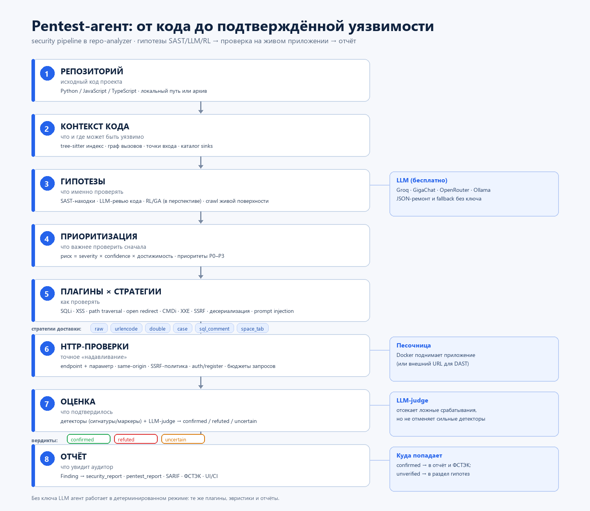

# Аудитор кода — монорепозиторий

Полный конвейер анализа репозиториев: веб-фронтенд приёма заявок, продюсер-воркер
и анализатор (Bandit + pip-audit + AST, опционально ИИ). Слияние фронтенда и бэкенда
принято в `master` (PR #1); ветка `feature/scan-options` добавляет выбор методов
анализа, форматов отчётов и модели ИИ. Связь между сервисами — **только файловый
контракт** через общее дерево `data/`, никакого прямого HTTP между ними нет.

## Pentest-агент (security pipeline)

В ветке `feature/pentest-agent-ui` (поверх `feature/security-pentest-agent`)
галочка **«Пентест»** в форме включает runner `manual`: ревью кода строит
гипотезы, агент проверяет их на живом приложении в песочнице (плагины,
стратегии, LLM-judge) и пишет секцию **«Пентест»** в единый отчёт.



Кратко: репозиторий → контекст (tree-sitter, граф вызовов, точки входа, sinks) →
гипотезы → приоритизация → плагины × стратегии → HTTP-проверки → детекторы +
judge → `Finding` (`source=pentest|llm-review`) в отчёте / SARIF / ФСТЭК.

Подробности: [docs/PENTEST_AGENT_OVERVIEW.md](docs/PENTEST_AGENT_OVERVIEW.md) ·
[docs/SECURITY_PIPELINE.md](docs/SECURITY_PIPELINE.md) ·
[docs/LLM_PROVIDERS.md](docs/LLM_PROVIDERS.md) ·
[docs/process.md](docs/process.md) (галочки UI и артефакты).

```
Браузер ──HTTP──▶ WEB :8000 ──пишет──▶ data/uploads/{id}/  +  data/queue/{id}.json
                                             │
WORKER ──поллинг queue/──▶ CLAIM (rename .claimed)
   │  вызывает библиотеку ANALYZATOR (IngestService → ScanOrchestrator)
   │  bandit / pip-audit / AST — субпроцессы; GitHub-ссылки клонируются (git --depth 1)
   ▼
data/reports/{id}/  ◀──пишет WORKER──  manifest.json · summary.json · report.html · {doc,fstec}.{html,md,pdf} · codedocs.zip
                                             │
Браузер ◀──HTMX-поллинг /scan/{id}/body── WEB читает manifest/summary и раздаёт артефакты
```

- **Веб-фронтенд** (`frontend/`) — приём репозитория (zip / файлы / ссылка GitHub-GitLab),
  выбор методов анализа, форматов результатов и модели ИИ, защита от zip-бомб на входе,
  страница статуса с таймингами, просмотр и скачивание готовых артефактов.
  Подробнее: [`frontend/README.md`](frontend/README.md).
- **Воркер** (`worker/`) — продюсер: забирает задачи из `data/queue/`, сверяет выбранное
  с контрактными конфигами (`frontend/config/analysis.yaml`, `reports.yaml`), запускает
  анализ, рендерит документы в выбранных форматах, пишет `summary.json` (donut + тайминги)
  и `manifest.json` (этапы статуса).
- **Анализатор** (`app/`) — библиотека для воркера и самостоятельный HTTP-сервис
  (`/api/v1/...`) для отладки; оригинальные README-разделы ниже.

## Файловый контракт (единственная точка интеграции)

| Дерево | Кто пишет | Кто читает |
|---|---|---|
| `data/queue/{scan_id}.json` | web (при подаче заявки): `{scan_id, created_at, source, options}` | worker (забирает rename'ом в `.claimed`) |
| `data/uploads/{scan_id}/repo/` | web (распакованный payload; **одинаковый layout для zip и отдельных файлов**) | worker (для zip/файлов; клонирование — на воркере) |
| `data/reports/{scan_id}/manifest.json` | worker: `stages: {analysis, report}` + список артефактов | web: слияние со статусом + HTMX-поллинг |
| `data/reports/{scan_id}/summary.json` | worker: `{"severities": {...}, "timing": {...}}` | web: donut-виджет (тайминги — машинные данные, UI их не показывает) |
| `data/reports/{scan_id}/{document}.{format}` | worker: `report.html`, `doc` и `fstec` в HTML, Markdown или PDF, `codedocs.zip` | web: sandboxed iframe + скачивание |
| `data/workspaces/{project_id}/` | анализатор (своё хранилище) | — |

Этап `intake` принадлежит веб-фронтенду и в манифестах воркера не участвует.
При сбое воркер помечает `fail` текущий и все последующие этапы — страница статуса
останавливает поллинг только когда все этапы терминальны.

## Быстрый старт (без Docker, два процесса)

Требования: Python 3.11+, git (для клонирования ссылок), сеть для pip-audit и GitHub.

```bash
# Windows; venv один на всё
py -3.12 -m venv .venv
.venv\Scripts\pip install -r requirements.txt
.venv\Scripts\pip install -r frontend\web\requirements.lock

# 1) веб-фронтенд
set SIRIUS_DATA_DIR=%cd%\data
.venv\Scripts\python -m uvicorn app.main:app --app-dir frontend\web --port 8000

# 2) воркер (второй терминал, из корня репозитория)
.venv\Scripts\python -m worker
```

Открыть http://127.0.0.1:8000/ , подать репозиторий (ссылка или zip) — статус,
отчёт и документация появятся автоматически после завершения анализа.

Linux/macOS: те же команды с `python3 -m venv .venv`, `export SIRIUS_DATA_DIR=$PWD/data`,
пути `frontend/web` через `/`.

## Docker

```bash
docker compose up --build
```

Два сервиса: `web` (:8000) и `worker`, общий volume `./data`. Конфиг воркера —
`worker/config/worker.yaml`, переопределения через env: `WORKER_DATA_DIR`,
`WORKER_POLL_INTERVAL_SECONDS`, `WORKER_ENABLE_AI` (+ `AI_API_KEY` для ИИ-анализа).

## Документация для передачи

- [`docs/SPEC.md`](docs/SPEC.md) — **инженерная спецификация / handoff**: контракты, запуск, чеклист приёмки, что нельзя ломать.
- [`docs/process.md`](docs/process.md) — смысл процесса для пользователя (методы, форматы, что в отчёте).
- [`docs/REPORT.md`](docs/REPORT.md) / [`docs/BENCHMARK.md`](docs/BENCHMARK.md) — research-контур secaudit / bench (не UI).
- [`docs/LIVE_SEQUENCE_RUNNER.md`](docs/LIVE_SEQUENCE_RUNNER.md) — live HTTP-обход + GA/Q-learning (lab, не UI).

## Содержание

- [Быстрый старт](#быстрый-старт-без-docker-два-процесса)
- [Файловый контракт](#файловый-контракт-единственная-точка-интеграции)
- [Анализатор: API](#анализатор-api)
- [Анализатор: языковые плагины](#языковые-плагины)
- [Анализатор: ИИ-анализ](#ии-анализ)
- [Структура](#структура)
- [Тесты](#тесты)

---

## Анализатор: API

Сервис запускается отдельно для отладки (`uvicorn app.main:app --port 8000`, Swagger `/docs`).
Воркер использует те же классы напрямую как библиотеку.

| Источник | Запрос |
|---|---|
| Локальный путь | `POST /api/v1/projects` → `{"source_type":"local_path","local_path":"C:/path/to/repo"}` |
| GitHub | `POST /api/v1/projects` → `{"source_type":"github","github_url":"https://github.com/org/repo"}` |
| ZIP | `POST /api/v1/projects/upload` — multipart |

Скан: `POST /api/v1/projects/{id}/scans` (тело необязательно). Тело — переопределения
на один скан: `{"enable_ai": true}`, `{"methods": ["static", "ai"]}` (ключи раннеров,
см. `app/analysis/registry.py` и `methods:` в `config/settings.yaml`).
Модель ИИ клиенту не выбирается — всегда `ai.model` из settings.yaml (или `AI_MODEL`).
Отчёты: `GET …/reports/security?format=markdown|json`, `GET …/reports/fstec?format=markdown`.
Результат целиком: `GET /api/v1/projects/{id}/scans/{scan_id}/result`.

> Черновик ФСТЭК **не является** полным сертифицированным комплектом по приказу №76.

## Языковые плагины

В [`config/settings.yaml`](config/settings.yaml):

```yaml
enabled_languages:
  - python
  # - javascript   # stub, пока не реализован
```

- Контракт: [`app/languages/base.py`](app/languages/base.py) — `detect` / `analyze`.
- **Python:** Bandit + pip-audit + инвентаризация модулей/классов/функций/импортов.

## ИИ-анализ

Post-scan review отобранных файлов через OpenAI-compatible API, `source=ai` у находок.
Не заменяет Bandit/pip-audit; ошибка LLM не валит скан.

1. `ai.enabled: true` в [`config/settings.yaml`](config/settings.yaml) (или `WORKER_ENABLE_AI=true` у воркера)
2. `AI_API_KEY=…` (обязательно), опционально `AI_BASE_URL`, `AI_MODEL`

Без ключа модуль тихо пропускается (`meta.ai.status=skipped`). Модель ИИ клиенту
не выбирается — используется `ai.model` из settings.yaml (или `AI_MODEL` из env);
использованная модель видна в `meta.ai.model`.

## Методы анализа и форматы результатов

Выбор клиента живёт в двух контрактных конфигах — их читают и форма, и воркер:

- [`frontend/config/analysis.yaml`](frontend/config/analysis.yaml) — методы анализа
  (`sast`, `llm_agentic`, `dast`, `pentest`; у `pentest` сейчас `available: true`,
  runner `manual`). Методы с `available: false` видны отключёнными («запланировано»)
  и отклоняются API. Воркер мапит id → runners (`static` / `ai` / `dynamic` /
  `manual`) и передаёт список в `ScanOrchestrator`. Модель ИИ клиенту не выбирается.
- [`frontend/config/reports.yaml`](frontend/config/reports.yaml) задаёт форматы
  артефактов. Отчёт аудита (`report.*`) и `doc.*` публикуются **сразу** после
  анализа; LLM-документы `fstec.*` и `codedocs.zip` дописываются после (лимиты
  промпта и таймауты — в `worker/config/worker.yaml` → `ai_documents`).

Движки форматов включаются в `worker/config/worker.yaml` (`formats:`). PDF —
WeasyPrint, DOCX — python-docx + htmldocx; зависимости импортируются лениво,
поэтому сканы без «тяжёлых» форматов работают без установленных пакетов.
WeasyPrint требует runtime GTK/Pango (в Linux-образах есть; на Windows без него
PDF-этап завершится ошибкой отчёта).

## Структура

```text
app/              # анализатор (библиотека + HTTP-сервис)
  analysis/       # реестр раннеров анализа (methods → static/ai/…)
config/           # settings.yaml анализатора
templates/        # Jinja2 markdown-шаблоны анализатора
worker/           # продюсер: queue → analyzer → отчёты фронтенду
  config/worker.yaml
  formats.py      # обработчики форматов (md/pdf/docx)
  templates/      # report.html.j2, doc.html.j2
frontend/         # веб-фронтенд (см. frontend/README.md)
  config/analysis.yaml   # методы анализа + модели ИИ (контракт)
  config/reports.yaml    # форматы × документы (контракт)
data/             # runtime: queue/ uploads/ reports/ workspaces/ (gitignored)
```

## Тесты

```bash
.venv/Scripts/python -m pytest worker/tests -q                  # воркер (офлайн; pdf-тест требует weasyprint)
cd frontend/web && ../../.venv/Scripts/python -m pytest     # фронтенд
pytest -q                                                       # анализатор (pip-audit требует сеть)
```
