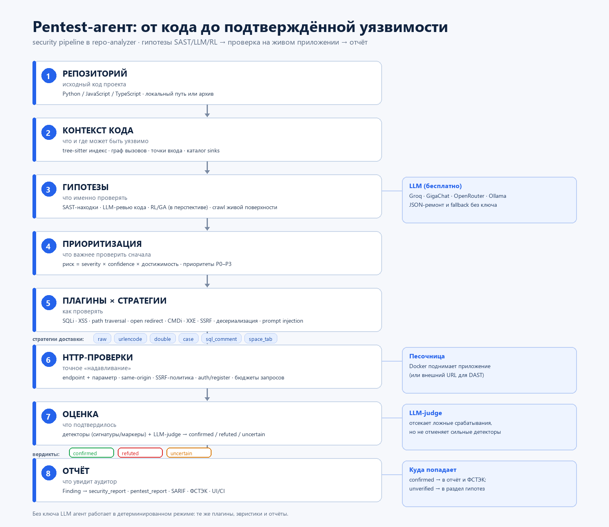

# Pentest-агент: как он работает (кратко)



Схема в SVG: [`images/pentest-agent-flow.svg`](images/pentest-agent-flow.svg)
(генератор — `images/make_pentest_agent_flow.py`, нужен `pillow`).

## Один абзац

Агент не «сканирует всё подряд»: сначала он **понимает код**. Из репозитория
строится контекст (индекс tree-sitter, граф вызовов, точки входа, каталог
опасных вызовов), затем появляются **гипотезы** — «вот здесь, вероятно, SQLi,
вот тут command injection». Гипотезы приходят из SAST-находок, LLM-ревью кода и
(в перспективе) из RL/GA-модуля; если маршрут не выводится из кода, включается
crawl живой поверхности. Дальше каждая гипотеза превращается в конкретные
HTTP-пробы: **плагин** (класс уязвимости) × **стратегия** (кодирование payload),
точный endpoint и параметр. Пробы идут в запущенное приложение (в песочнице
Docker или по внешнему URL) с бюджетами, same-origin и SSRF-политикой.
Сработавшие детекторы подтверждает (или опровергает) **LLM-judge**, после чего
подтверждённые находки попадают в общий `Finding` и отчёты: `security_report`,
`pentest_report`, SARIF, черновик ФСТЭК, UI/CI.

## По шагам

| Шаг | Что происходит | Где в коде |
|---|---|---|
| 1. Репозиторий | код проекта (Python/JS/TS), локальный путь или архив | ingest + `ScanOrchestrator` |
| 2. Контекст | tree-sitter индекс, граф вызовов, точки входа, `sinks.yaml` | `app/context/*` |
| 3. Гипотезы | SAST-находки → `VulnHypothesis`; LLM-ревью (direct/agentic); crawl-фолбэк; задел `Source.rl` | `app/security/code_review.py`, `sast_adapter.py` |
| 4. Приоритизация | риск = severity × confidence × достижимость, P0–P3 | `app/security/risk.py` |
| 5. Плагины × стратегии | SQLi, XSS, traversal, redirect, CMDi, XXE, SSRF, десериализация, prompt injection; raw/urlencode/double/case/comment | `plugins.py`, `strategies.py` |
| 6. HTTP-проверки | точный endpoint+param, same-origin, SSRF-политика, auth/register, бюджеты | `verifier.py`, `app/dast/agent/target.py` |
| 7. Оценка | детекторы + LLM-judge → confirmed / refuted / uncertain | `judge.py` |
| 8. Отчёт | `Finding(source=pentest|llm-review)` → security_report, pentest_report, SARIF, ФСТЭК | `report.py`, `app/services/report/*` |

## Три режима LLM

- **direct** (по умолчанию): один запрос — модели дают обзор репозитория и окна
  кода кандидатов; подходит для бесплатного Groq (8k TPM).
- **tools**: агентный цикл с `read_file/grep/outline/...` через function calling;
  для провайдеров с запасом токенов (GigaChat, платные ключи, локальная Ollama).
- **без ключа**: детерминированное ревью — те же плагины, эвристики и отчёты.

Провайдеры: Groq, GigaChat, OpenRouter, Gemini, Ollama; ключи только через env.
Подробности — [LLM_PROVIDERS.md](LLM_PROVIDERS.md). Что именно делает LLM, а что
делает детерминированный код, — [LLM_ROLE.md](LLM_ROLE.md).

## Быстрый запуск

```powershell
# только ревью кода
.\.venv\Scripts\python -m app.security review --repo C:\path\to\repo --out data\security\review

# ревью + проверка на живом приложении
.\.venv\Scripts\python -m app.security scan --repo C:\path\to\repo `
  --url http://127.0.0.1:5000 --allow-private --out data\security\run
```

С LLM (бесплатный Groq):

```powershell
$env:GROQ_API_KEY = "gsk_..."
.\.venv\Scripts\python -m app.security review --repo C:\path\to\repo --llm-provider groq
```

## Что дальше по проекту

- RL/GA-находки подключаются как ещё один источник `VulnHypothesis`
  (`source=rl`) — конвейер проверки и отчётов не меняется.
- В `master` уже есть SAST/контекст/LLM-триаж; этот агент — следующий этап,
  который превращает статические гипотезы в подтверждённые динамикой находки.
