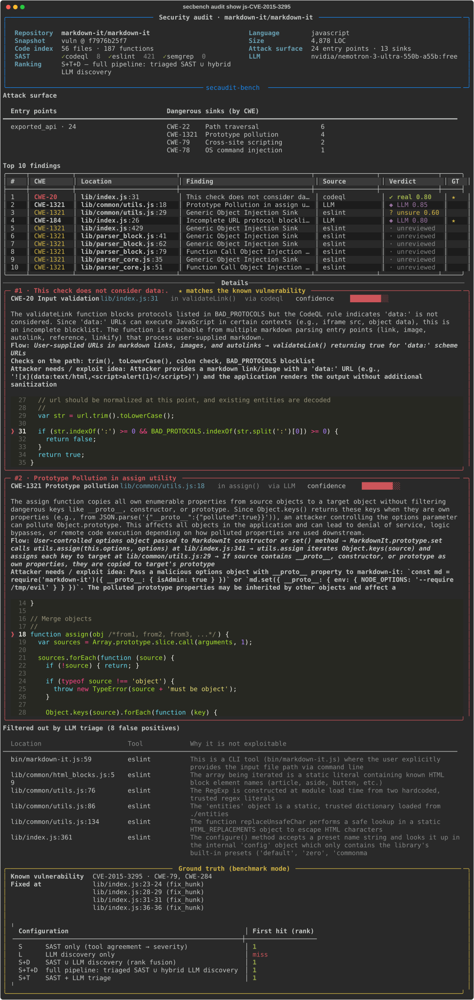
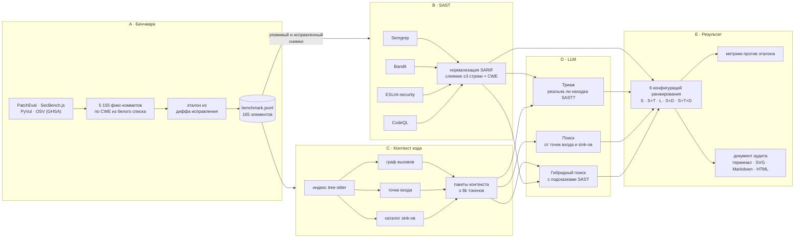
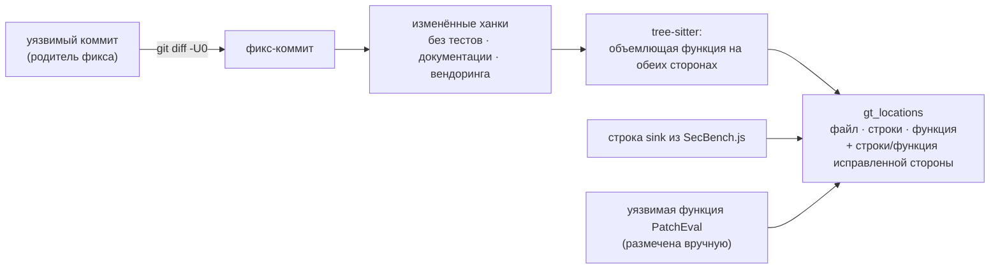
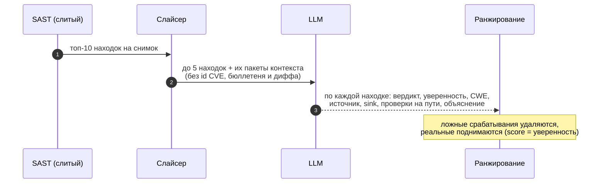
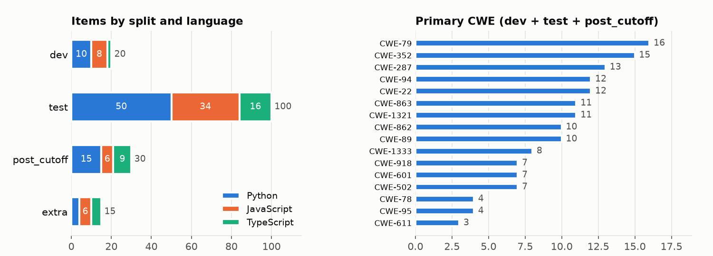
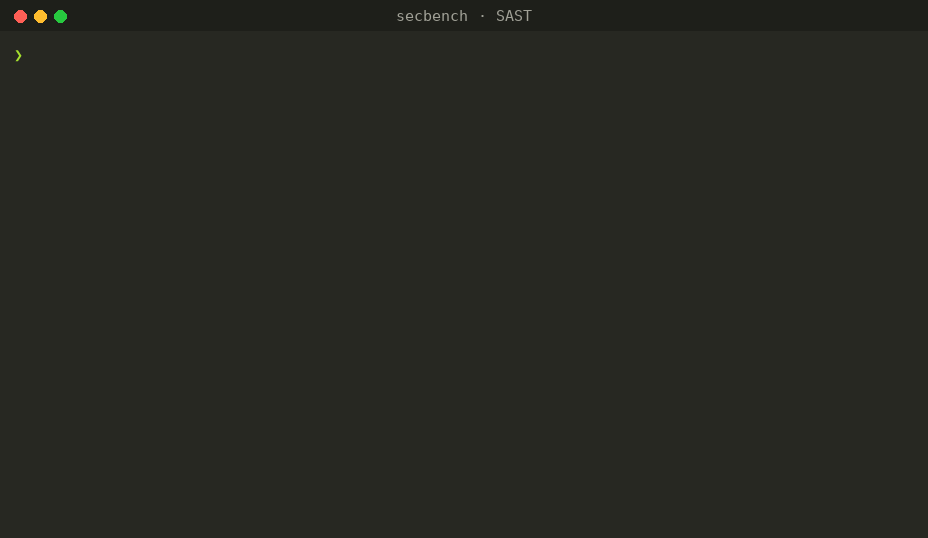
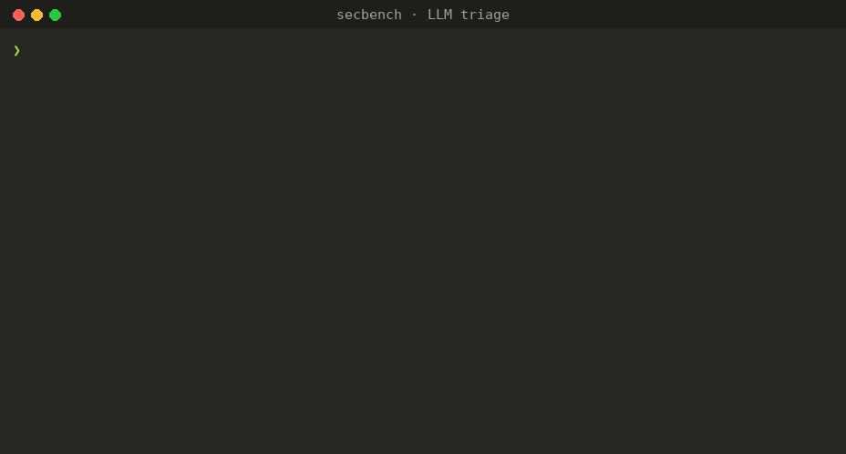
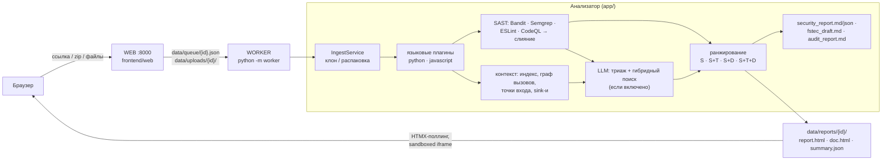
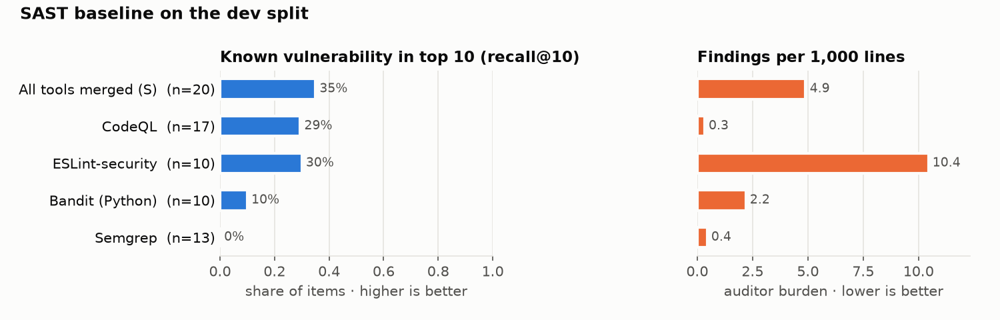
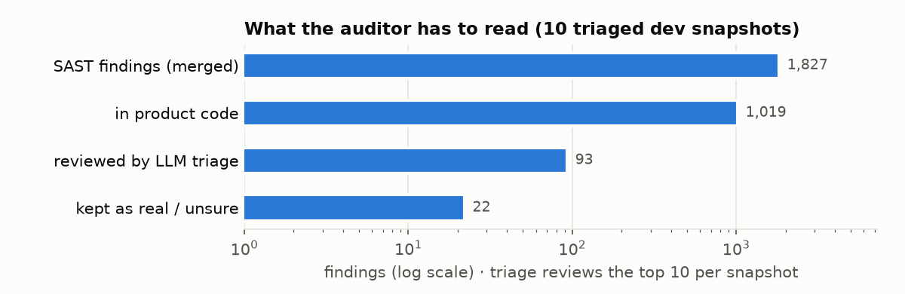

# Аудитор кода (secaudit) — как это работает и что находит

**Проект:** «Система автоматического построения документации безопасности кода для аудита» (Большие вызовы 2026)
**Статус:** 2026-11-18 · конвейер работает от начала до конца, встроен в сервис repo-analyzer (веб-интерфейс → очередь → воркер → анализатор) и в CLI · LLM запускались только на бесплатных моделях, поэтому **все цифры по LLM предварительные** (dev-выборка, несколько элементов)

Система принимает репозиторий на Python или JS/TS и строит **документ аудита**:
- ранжированный список вероятных уязвимостей;
- для каждой — объяснение простым языком, поток данных source → sink, проверки, уже стоящие на пути, и что нужно атакующему;
- значимый фрагмент кода с выделенными строками;
- список предупреждений статического анализа, которые система отклонила, и причины.

Чтобы понимать, хорош ли такой документ, мы собрали бенчмарк из **165 реальных уязвимостей (CVE)** с известным ответом и оцениваем на нём каждую конфигурацию.

<p align="center"></p>
<p align="center"><sub><code>python -m bench audit show js-CVE-2015-3295 --model nvidia/nemotron-3-ultra-550b-a55b:free --reveal-gt</code> · <a href="img/demo_audit.gif">анимированная версия</a></sub></p>

---

## Содержание

1. [Как это работает](#1-как-это-работает)
2. [Бенчмарк](#2-бенчмарк)
3. [Аудиторский отчёт (CLI)](#3-аудиторский-отчёт-cli)
4. [Работа в составе сервиса](#4-работа-в-составе-сервиса)
5. [Результаты на текущий момент](#5-результаты-на-текущий-момент)
6. [Разборы: что работает, а что нет](#6-разборы-что-работает-а-что-нет)
7. [Ограничения и дальнейшие шаги](#7-ограничения-и-дальнейшие-шаги)
8. [Воспроизведение](#8-воспроизведение)

---

## 1. Как это работает



Каждая стадия пишет JSON/JSONL на диск и пропускает уже сделанную работу, поэтому любую стадию можно перезапустить отдельно. Ответы LLM кешируются: повторный запуск ничего не стоит, а оценка никогда не обращается к API.

В репозитории стадии разложены по структуре сервиса: B — `app/sast/`, C — `app/context/`, D — `app/ai/` (триаж, поиск, клиент LLM), ранжирование и отчёт — `app/ai/rank.py`, `app/services/scan/ranking.py`, `app/services/report/audit.py`; бенчмарк и оценка (A, E) — пакет `bench/`.

### Стадия A — бенчмарк с известными ответами

Каждый элемент — одна CVE в одном реальном репозитории. Выгружаются **два снимка**: коммит прямо перед исправлением (*vuln*) и само исправление (*fixed*). Эталон — код, который изменило исправление.



- **Источники.** [PatchEval](https://github.com/bytedance/PatchEval)-Verified ([arXiv:2511.11019](https://arxiv.org/abs/2511.11019)) — вручную очищенные метки и PoC; [SecBench.js](https://github.com/cristianstaicu/SecBench.js) (ICSE 2023) — точные строки sink-ов и эксплойты; [PyVul](https://github.com/billquan/PyVul) ([arXiv:2509.04260](https://arxiv.org/abs/2509.04260)) — отобранные фикс-коммиты Python; [OSV.dev](https://osv.dev) ([GitHub advisories](https://github.com/advisories)) — всё остальное. Если одно исправление есть в нескольких источниках, берётся лучше размеченное.
- **Фильтры.**
  - Белый список из 16 классов веб-уязвимостей ([список](../README.md#бенчмарк)), не больше 25% на один CWE.
  - Одна уязвимость на репозиторий.
  - Размер: 2k–300k строк для Python, 300–300k для JS/TS.
  - Исправления, затрагивающие больше 10 файлов или 300 строк, считаются «запутанными» и уходят в отдельную выборку `extra`.
- **Защита от утечки.** CVE, опубликованные после даты обучения моделей, образуют отдельную выборку `post_cutoff`. Модель, которая заметно лучше справляется со старыми CVE, чем с новыми, скорее всего их помнит, а не находит.

### Стадия B — четыре SAST-инструмента, один список

[Semgrep](https://semgrep.dev), [Bandit](https://github.com/PyCQA/bandit) (только Python), [ESLint](https://eslint.org) с [`eslint-plugin-security`](https://github.com/eslint-community/eslint-plugin-security) (только JS/TS) и [CodeQL](https://codeql.github.com) (наборы `security-extended`) запускаются на обоих снимках. Их вывод SARIF приводится к одному формату. Предупреждения разных инструментов, попавшие в пределы 3 строк друг от друга со связанными CWE, **сливаются**: «согласны 3 инструмента» считается один раз и ранжируется выше. Пути потока данных CodeQL сохраняются — это самый полезный контекст для LLM.

### Стадия C — контекст, которым LLM может воспользоваться

Целый репозиторий не помещается в промпт, и большая его часть не относится к делу. Стадия C строит:
- **индекс функций** ([tree-sitter](https://tree-sitter.github.io));
- **приблизительный граф вызовов** (по именам);
- **точки входа**: маршруты Flask/Django/FastAPI, обработчики Express/Koa, экспортируемый API npm-пакетов, точки входа CLI;
- **каталог опасных вызовов** с привязкой к CWE (`config/sinks.yaml`).

Для любого места **слайсер** собирает пакет контекста в пределах бюджета токенов: объемлющая функция целиком, вызывающие до двух уровней, вызываемые, ведущие к sink-у, путь потока данных SAST и импорты файла.

### Стадия D — две задачи для LLM



- **Триаж (T)** отвечает на вопрос «реально ли это предупреждение SAST?», проверяя три вещи: контролирует ли источник атакующий, есть ли санитизация на пути и достижим ли sink из точки входа.
- **Поиск (D)** оценивает каждую функцию (точка входа, опасный вызов внутри или в двух вызовах, логика аутентификации/криптографии, рискованные имена файлов, достижимость из точки входа). Топ-6–12 отправляются в LLM по 5 на промпт с просьбой назвать конкретные уязвимости с точными строками.
- **Гибридный поиск (D+)** — поиск плюс предупреждения SAST для этих функций в качестве подсказок.

Эталон никогда не попадает в промпт. Идентификаторы CVE и GHSA в комментариях кода вычищаются, а каждый промпт проверяется утверждением.

### Стадия E — шесть способов ранжирования, одна таблица результатов

| Конфигурация | Что видит аудитор |
|---|---|
| `S` | все SAST-инструменты слиты, порядок: согласие инструментов, затем критичность |
| `S-<tool>` | один инструмент |
| `L` | только поиск LLM |
| `S+T` | SAST, переранжированный триажем; ложные срабатывания удалены |
| `S+D` | SAST и поиск, объединённые слиянием рангов (reciprocal-rank fusion) |
| `S+T+D` | SAST после триажа, объединённый с гибридным поиском: полный конвейер |

**Метрики:**
- **recall@k:** есть ли известная уязвимость среди первых *k* находок? Попадание — та же функция, что в исправлении (основная метрика), или ±5 строк (дополнительная).
- **MRR:** насколько высоко стоит первое попадание.
- **PairAcc:** отмечено на *vuln* **и** не отмечено на *fixed*. Отделяет понимание ошибки от реакции на «страшный» код.
- **Находок на 1 000 строк:** сколько придётся читать аудитору.
- **Точность, полнота триажа и сокращение ложных срабатываний.**
- 95% бутстрап-доверительные интервалы и тесты МакНемара для парных сравнений.

---

## 2. Бенчмарк



| | |
|---|---|
| Элементы | **165**: 20 dev (только настройка промптов) · 100 test · 30 post_cutoff · 15 extra (запутанные) |
| Языки | 79 Python · 54 JavaScript · 32 TypeScript |
| Эталон | 3 055 мест: ханки исправления на обеих сторонах, плюс строки sink-ов SecBench.js и вручную размеченные уязвимые функции PatchEval, где они есть |
| Время сборки | ~12 мин из 10 564 фикс-коммитов OSV + 1 155 PyVul + 216 SecBench.js + 147 кандидатов PatchEval |
| Выгрузка | 165/165 элементов, оба снимка |
| Самая большая доля CWE | [CWE-79](https://cwe.mitre.org/data/definitions/79.html) (XSS), 12% dev+test |

Все элементы со ссылками на бюллетень, репозиторий и фикс-коммит: **[BENCHMARK.md](BENCHMARK.md)**.

Ещё предстоит: человек вручную проверяет 20% элементов test (`python -m bench bench manual-sample` готовит список с диффом каждого элемента).

---

## 3. Аудиторский отчёт (CLI)

Отчёт строится одними и теми же рендерерами (`app/services/report/audit.py`) в двух режимах:
- `python -m app scan <путь|zip|ссылка>` — для произвольного репозитория, тем же конвейером, что и сервис (см. [раздел 4](#4-работа-в-составе-сервиса));
- `python -m bench audit show <item>` — для снимка из бенчмарка, полностью из файлов на диске, без обращений к API, с возможностью показать известную уязвимость.

<table>
  <tr>
    <td width="50%"></td>
    <td width="50%"></td>
  </tr>
  <tr>
    <td align="center"><sub><code>sast run</code>: четыре анализатора, один слитый список</sub></td>
    <td align="center"><sub><code>llm triage</code> (воспроизведено из кеша, $0)</sub></td>
  </tr>
</table>

```bash
python -m app scan tests/fixtures/toy-py-flask --no-ai                 # SAST + контекст, без LLM
python -m app scan https://github.com/org/repo --ai --md audit.md      # с триажем и поиском LLM

scripts/sb audit show js-CVE-2015-3295 --model nvidia/nemotron-3-ultra-550b-a55b:free
scripts/sb audit show js-CVE-2015-3295 --model ... --reveal-gt          # режим бенчмарка: известная CVE отмечена ★
scripts/sb audit show js-CVE-2015-3295 --model ... --svg out.svg --md out.md
```

| Раздел | Что показывает |
|---|---|
| Заголовок | репозиторий, снимок, размер, индекс кода, поверхность атаки, запущенные SAST-инструменты (с числом находок), модель, конфигурация ранжирования |
| Поверхность атаки | точки входа по типам, опасные вызовы по CWE |
| Топ находок | ранг, CWE, место, заголовок, какой инструмент или LLM нашли, вердикт (`✔ real` / `? unsure` / `◆ LLM` / `· unreviewed`) и уверенность |
| Подробности | объяснение, поток source → sink, проверки на пути, что нужно атакующему, код с выделением |
| Отфильтровано | предупреждения SAST, отклонённые LLM, с причиной — аудитор видит, что скрыто и почему |
| Эталон | только `--reveal-gt`: известная CVE и ранг, который дала ей каждая конфигурация |

Экспорт в Markdown: [markdown-it (удачный случай)](examples/audit_markdown-it.md) · [clamscan (неудачный случай)](examples/audit_clamscan.md). Вёрстка подстраивается под узкий терминал: колонка *Source* убирается, заголовок складывается в столбец. Подписи терминального отчёта на английском (это инструмент разработчика); HTML-артефакты сервиса — на русском.

---

## 4. Работа в составе сервиса

Тот же конвейер работает внутри repo-analyzer: веб-интерфейс принимает репозиторий, воркер забирает задачу из очереди и вызывает анализатор как библиотеку. Связь между веб-частью и воркером — только файловый контракт в `data/`.



Что появляется в артефактах:

| Артефакт | Содержимое |
|---|---|
| `report.html` (отчёт аудита) | donut по критичности (без отклонённых ИИ находок), блок «Поверхность атаки и методика» (индекс кода, точки входа по типам, опасные вызовы по CWE, анализаторы со статусом и временем, модель), находки в порядке ранжирования: вердикт ИИ с уверенностью, объяснение, поток данных, проверки на пути, что нужно атакующему, фрагмент кода с выделенными строками, рекомендация; таблица «Отклонено ИИ-триажем» с обоснованиями |
| `doc.html` (черновик ФСТЭК) | паспорт исследования, **методика и средства анализа** (инструменты, режимы LLM, порядок находок), кодовая инвентаризация (для JS/TS — из индекса tree-sitter), **поверхность атаки**, протокол уязвимостей, выводы |
| `audit_report.md` (API анализатора) | тот же документ аудита, что печатает CLI: `GET /api/v1/projects/{id}/scans/{scan_id}/reports/audit` |

Настройки — в [`config/settings.yaml`](../config/settings.yaml): `sast.tools` (инструменты по языкам), секция `ai` (`modes: [triage, discovery]`, модель, base_url, лимиты запросов, бюджеты токенов). Отсутствующий инструмент пропускается и отмечается в отчёте; ошибка или исчерпанная квота LLM не валят скан — отчёт строится по тому, что успело выполниться. Ответы LLM кешируются в `data/llm_cache/`, повторный скан того же кода бесплатен.

Проверено вживую:
- `python -m app scan` на учебных приложениях из `tests/fixtures/`: заложенные уязвимости в топе; триаж Nemotron (2 запроса) подтвердил их с объяснениями и отклонил шум Bandit на `import pickle` / `import subprocess`.
- Скан публичного учебного [Vulnerable-Flask-App](https://github.com/we45/Vulnerable-Flask-App) по ссылке через веб-интерфейс (воркер, Python + JS, все четыре анализатора, триаж и поиск): 57 находок в порядке `S+T+D`, 12 подтверждены ИИ, 3 отклонены с обоснованием, 2 добавлены поиском. На середине стадии LLM закончилась бесплатная дневная квота OpenRouter — стадия остановилась (`partial`), скан и отчёты завершились штатно.

---

## 5. Результаты на текущий момент

> **Сначала прочтите это.** Всё ниже — на **dev-выборке**, предназначенной для настройки промптов, а не для итоговых чисел. Строки LLM покрывают 2–4 элемента, потому что одна бесплатная модель даёт 50 запросов в день. Они показывают, что конвейер работает и какие бывают ошибки, а не насколько он хорош.

### Базовый уровень SAST (все 20 элементов dev)



| | recall@1 | recall@10 | MRR | PairAcc@10 | находок / KLOC |
|---|---|---|---|---|---|
| **Все инструменты, слитые (`S`)** | 10% | **35%** [15–55] | 0.17 | 10% | 4.9 |
| CodeQL | 18% | 29% | 0.21 | 0% | **0.3** |
| ESLint-security (только JS) | 10% | 30% | 0.21 | 0% | 10.4 |
| Bandit (только Python) | 0% | 10% | 0.01 | 0% | 2.2 |
| Semgrep (правила реестра) | 0% | 0% | – | 0% | 0.4 |

- Слияние инструментов помогает: слитый список лучше любого отдельного инструмента. **CodeQL** даёт лучший сигнал при наименьшем шуме.
- **ESLint-security** находит ошибки в JS, но очень шумный: 10 находок на 1 000 строк, в основном «object injection» на каждом `obj[key]`.
- **Semgrep** с правилами реестра по умолчанию не нашёл ни одной из 20 известных уязвимостей.
- **PairAcc низкий (10% у слитого списка, 0% у каждого инструмента)**. SAST продолжает отмечать то же место и после исправления, то есть не отличает уязвимый код от исправленного.

### Что LLM делает со списком чтения аудитора



На уже размеченных триажем снимках dev (Nemotron-3 Ultra, бесплатно):
- **Отброшено 77% предполагаемых ложных срабатываний**: из 88 оставлено 20. Метки предполагаемые, выборку нужно проверить вручную.
- **Из 4 предупреждений, стоящих на реальной ошибке, сохранено 2**. Оба промаха — один и тот же случай clamscan, см. [Неудача 1](#-неудача-1--триаж-отвечает-на-вопрос-правила-а-не-на-настоящий).
- Точность вердиктов «реально» на предполагаемых метках — 0.13. Многие из них указывают на правдоподобные проблемы, не являющиеся CVE из бенчмарка, поэтому их нужно проверять, а не считать ошибками.

| Элемент (CWE) | `S` | `S+T` | `L` | `S+T+D` | Отмечена исправленная версия? |
|---|---|---|---|---|---|
| [markdown-it](https://github.com/markdown-it/markdown-it) [CVE-2015-3295](https://nvd.nist.gov/vuln/detail/CVE-2015-3295) ([XSS](https://cwe.mitre.org/data/definitions/79.html)) | **1** | **1** | промах | **1** | нет ✔ |
| [clamscan](https://github.com/kylefarris/clamscan) [CVE-2020-7613](https://nvd.nist.gov/vuln/detail/CVE-2020-7613) ([внедрение команд](https://cwe.mitre.org/data/definitions/78.html)) | 5 | **промах** | – | – | — |
| [keycloak-nodejs-connect](https://github.com/keycloak/keycloak-nodejs-connect) [CVE-2019-10157](https://nvd.nist.gov/vuln/detail/CVE-2019-10157) ([аутентификация](https://cwe.mitre.org/data/definitions/287.html)) | промах | промах | промах | промах | — |
| (ранг известной уязвимости; – = ещё не запускалось) | | | | | |

**Стоимость:** $0 (бесплатный уровень [OpenRouter](https://openrouter.ai)). 39 вызовов API, около 148k токенов промпта и 88k токенов ответа. Бесплатный эндпоинт Nemotron отвечает примерно за 60–90 с на вызов.

---

## 6. Разборы: что работает, а что нет

### ✅ Удача 1 — триаж подтверждает реальную XSS и объясняет её как аудитор

**[markdown-it](https://github.com/markdown-it/markdown-it), [CVE-2015-3295](https://nvd.nist.gov/vuln/detail/CVE-2015-3295)** ([фикс-коммит](https://github.com/markdown-it/markdown-it/commit/f76d3beb46abd121892a2e2e5c78376354c214e3)). `validateLink()` блокирует `javascript:`, `vbscript:` и `file:`, но не `data:`, поэтому `` проходит в отрендеренный HTML. Исправление добавило `data` в блок-лист и разрешило только MIME-типы изображений.

CodeQL отмечает строку 31 общим сообщением («эта проверка не учитывает data:»). LLM превращает это в находку, с которой аудитор может работать (ответ модели, в оригинале):

> *"Since 'data:' URLs can execute JavaScript in certain contexts (e.g., iframe src, object data), this is an incomplete blocklist. The function is reachable from multiple markdown parsing entry points (link, image, autolink, reference, linkify) that process user-supplied markdown."*
> **Проверки на пути:** `trim()`, `toLowerCase()`, проверка двоеточия, блок-лист `BAD_PROTOCOLS`.

- **Гибридный поиск нашёл ту же ошибку самостоятельно** («Incomplete URL protocol blocklist allows data: URIs», [CWE-184](https://cwe.mitre.org/data/definitions/184.html), уверенность 0.80).
- **На исправленном снимке находка исчезает**, то есть конвейер отличает уязвимую версию от исправленной (PairAcc ✔).

### ✅ Удача 2 — отклонение шума с причинами, которые человек может проверить

ESLint отметил 421 место в 4 878 строках markdown-it. Из 10 верхних, просмотренных триажем, 8 отклонены, у каждого — конкретная причина:

| Место | Инструмент | Причина (ответ модели) |
|---|---|---|
| `lib/common/utils.js:76` | eslint | *The RegExp is constructed at module load time from two hardcoded, trusted regex literals* |
| `lib/common/utils.js:86` | eslint | *The 'entities' object is a static, trusted dictionary loaded from ./entities* |
| `lib/index.js:361` | eslint | *The configure() method accepts a preset name string and looks it up in the internal 'config' object which only contains the library's built-in presets* |

Это разница между «так сказал инструмент» и тем, что аудитор проверит за секунды. Отклонённые находки остаются видны в отчёте (в `report.html` — отдельной таблицей).

### ✅ Удача 3 — возможные проблемы, на которые стоит посмотреть

В clamscan CodeQL и ESLint оба отмечают `/^ERROR: Can't access file (.*)+$/` в `index.js:1172`, и триаж признаёт находку реальной (0.85):

> *"The regex uses a nested quantifier `(.*)+` which exhibits exponential backtracking … clamscan error messages include scanned filenames."*

Это не CVE из бенчмарка, поэтому в метриках она считается ложным срабатыванием. Но это правдоподобный [ReDoS](https://cwe.mitre.org/data/definitions/1333.html) и естественный кандидат для ручного поиска новых уязвимостей (стадия F). Конвейер не утверждает, что она реальна: он ставит её в список и объясняет, почему она может быть реальной.

### ❌ Неудача 1 — триаж отвечает на вопрос правила, а не на настоящий

**[clamscan](https://github.com/kylefarris/clamscan), [CVE-2020-7613](https://nvd.nist.gov/vuln/detail/CVE-2020-7613)** ([фикс-коммит](https://github.com/kylefarris/clamscan/commit/5f557c970817fe8c578ec3f7ad3bcbcef4cf5538)) — [внедрение команд ОС](https://cwe.mitre.org/data/definitions/78.html): переданный пользователем `path` к бинарнику попадает в `exec()`.

```js
const version_cmds = { clamdscan: `${path} --version`, clamscan: `${path} --version` };
...
const {stdout} = await cp_exec(version_cmds[scanner]);   // ← исправление заменило это на execFile()
```

- ESLint отметил ровно эту строку, но как **«object injection»** (`version_cmds[scanner]`). CodeQL её не отметил: `path` приходит из опций библиотеки, а не из веб-запроса.
- LLM правильно ответила на заданный вопрос: *scanner может быть только 'clamscan' или 'clamdscan', значит обращение к объекту безопасно* — и отклонила находку.
- Внедрение в оболочку на той же строке она не рассмотрела. **Реальная ошибка упала с 5-го места (`S`) до отсутствия в списке (`S+T`).**

**Что изменить:** спрашивать «есть ли в этом месте какая-либо уязвимость?» вместо «право ли правило?» и передавать в промпт триажа опасные вызовы из каталога sink-ов (здесь `exec`).

### ❌ Неудача 2 — уверенные утверждения, которые не выдерживают проверки

Поиск только силами LLM пропустил XSS в markdown-it и вместо неё сообщил о **[загрязнении прототипа](https://cwe.mitre.org/data/definitions/1321.html) в `assign()`**. То же самое он сообщил и на *исправленном* снимке, где этот код не менялся. В двух запусках с разными наборами кандидатов одно и то же утверждение получало уверенность от 0.65 до 0.90.

Утверждение неверно. `obj[key] = source[key]` при `key = "__proto__"` меняет прототип *этого одного объекта*, а не `Object.prototype`, так что глобального загрязнения нет. Разброс уверенности в 0.25 на одинаковом коде показывает, что числа не откалиброваны.

**Что изменить:** добавить второй проход «докажи», требующий конкретного контролируемого атакующим входа и достижимого пути, и откалибровать уверенность на dev.

### ❌ Неудача 3 — LLM не найдёт то, чего не видит

**[keycloak-nodejs-connect](https://github.com/keycloak/keycloak-nodejs-connect), [CVE-2019-10157](https://nvd.nist.gov/vuln/detail/CVE-2019-10157)** ([фикс-коммит](https://github.com/keycloak/keycloak-nodejs-connect/commit/55e54b55d05ba636bc125a8f3d39f0052d13f8f6), [CWE-345](https://cwe.mitre.org/data/definitions/345.html)). Эндпоинт выхода администратора декодирует JWT и действует по нему **без проверки подписи**:

```js
let parts = data.split('.');
let payload = JSON.parse(Buffer.from(parts[1], 'base64').toString());   // подпись не проверяется
if (payload.action === 'LOGOUT') { ... }
```

- Ни один SAST-инструмент ничего не сообщил в этом файле: в логике аутентификации нет «опасного вызова», который они могли бы сопоставить.
- Поиск должен это ловить, но функция оказалась **9-й** среди кандидатов, а отправлены были только первые 7, так что модель её не увидела.

**Уже исправлено на dev:**
- `module.exports = function…` теперь считается точкой входа.
- Функции, работающие с аутентификацией/криптографией (`JSON.parse`, `Buffer.from`, `verify`, `jwt`…), и функции, достижимые из точки входа, получают бонус.

Уязвимый обработчик теперь на **4-м** месте. Повторный запуск поиска на нём ждёт завтрашней бесплатной квоты.

### ❌ Неудача 4 — практические ограничения бесплатных моделей

| Проблема | Последствие | Что сделано |
|---|---|---|
| 50 бесплатных запросов в день | одна модель на 20 элементах dev ≈ 4 дня | пакетные промпты (429 → ~200 запросов); кеш ответов; аккуратная остановка на лимите |
| [Gemma-4 31B](https://openrouter.ai/google/gemma-4-31b-it:free) (бесплатно) | общий пул провайдера исчерпан (429) | быстрый отказ после 3 попыток вместо повторов в течение минут |
| [Nemotron-3 Ultra](https://openrouter.ai/nvidia/nemotron-3-ultra-550b-a55b:free) (бесплатно) | модель с рассуждениями, 60–90 с на вызов; рассуждения съедали бюджет ответа | `reasoning: {effort: low}` и дополнительный запас токенов |
| Выборка test (100 элементов) ≈ 1 000 запросов на модель | непрактично на бесплатном уровне | офлайн-пакет на GPU Kaggle/Colab (`scripts/kaggle_vllm_batch.py`) |

---

## 7. Ограничения и дальнейшие шаги

**Ограничения**
- Все числа по LLM получены на 2–4 элементах dev. Настоящее сравнение требует выборки test из 100 элементов и 2–3 моделей.
- Эталон означает «где исправление изменило код». Без ручной проверки 20% точность меток неизвестна, поэтому мы считаем попадания на уровне функции, а не отдельных строк.
- Граф вызовов строится по именам, так что динамическая диспетчеризация и колбэки учитываются приблизительно.
- «Ложные срабатывания» бенчмарка могут оказаться реальными неизвестными ошибками (Удача 3), поэтому точность указывается как *предполагаемая*.
- В сервисе бесплатный уровень (50 запросов в день) хватает на несколько сканов с LLM в день; для постоянной работы нужен платный ключ (`ai.budget_usd`) или собственный vLLM/Ollama (`ai.base_url`).

**Дальнейшие шаги**
1. Закончить прогон dev, затем исправить Неудачи 1 и 2: триаж, рассматривающий место целиком, и проверочный проход для поиска. После этого заморозить промпты.
2. Прогнать выборки test и post_cutoff: Nemotron через OpenRouter за несколько дней плюс Qwen2.5-Coder через пакет Kaggle. Привести доверительные интервалы и тесты МакНемара против `S`.
3. Выполнить ручную проверку 20% эталона и ручную проверку выборки меток триажа.
4. Стадия F: просмотреть верхние находки «не CVE» на текущих HEAD и приватно сообщить о подтверждённых проблемах.

---

## 8. Воспроизведение

```bash
bash scripts/setup.sh                           # инструменты (Linux x86-64, без sudo), venv ~/.venvs/repo-analyzer
scripts/sb --pytest                             # тесты, включая анализаторы на приложениях с заложенными ошибками

# сервис / CLI на произвольном репозитории
scripts/sb app scan tests/fixtures/toy-js-express --no-ai
scripts/sb app scan https://github.com/org/repo --ai --modes triage,discovery --md audit.md

# бенчмарк
scripts/sb bench build && scripts/sb bench checkout
scripts/sb sast run --split dev
scripts/sb context build --split dev
scripts/sb llm triage   --model nvidia/nemotron-3-ultra-550b-a55b:free --split dev
scripts/sb llm discover --model nvidia/nemotron-3-ultra-550b-a55b:free --split dev [--hybrid]
scripts/sb eval run && scripts/sb eval report   # results/report.md, metrics.json
SECBENCH_DATA=~/secbench-data ~/.venvs/repo-analyzer/bin/python scripts/make_report_figures.py   # docs/img/*.png
scripts/sb audit show <item-id> --model <model> --reveal-gt --svg docs/img/x.svg --md docs/examples/x.md
```
