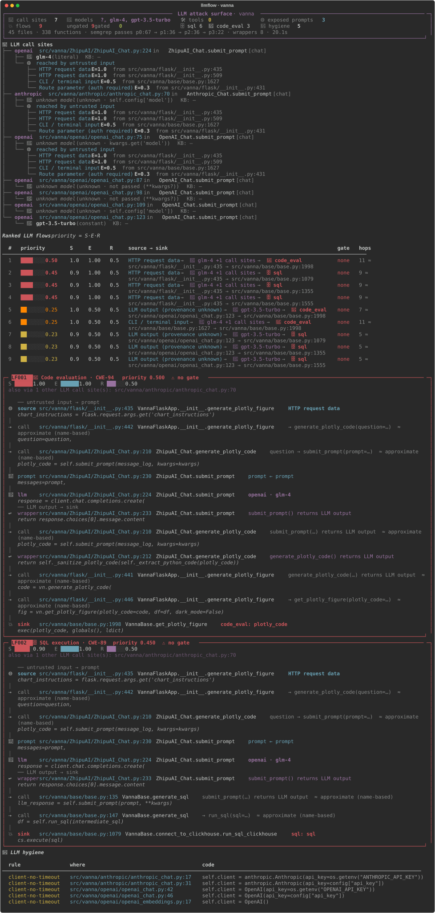
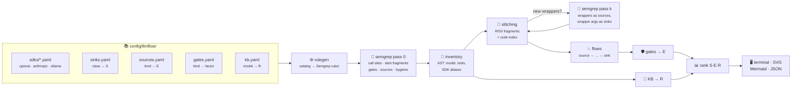

# llmflow — security analysis of LLM-integrated code

> **Untrusted input → prompt → LLM → dangerous sink.**
> llmflow finds these paths in Python code, follows them across functions and files, checks what guards them, and ranks them by `priority = S · E · R`.

Plain SAST does not model this class of bug. A model's answer is just the return value of `client.chat.completions.create(...)`, so a rule pack has no reason to treat it as attacker-controlled. If a web page or a user question can steer that answer, it reaches `subprocess.run`, `cursor.execute` or `exec`.

For example, on Vanna 0.5.5 ([CVE-2024-5565](https://nvd.nist.gov/vuln/detail/CVE-2024-5565)):
- **Plain Semgrep** (`p/python`, 151 rules) reports **0 findings**.
- **llmflow** ranks `flask.request → generate_plotly_code → submit_prompt → LLM → exec` as finding **#1** (see [examples](examples.md)).



---

## Contents

| Doc | What's inside |
|---|---|
| **README** (this page) | What it is, quick start, how the pipeline works |
| [catalog.md](catalog.md) | YAML catalog: SDKs, sinks, sources, gates, model KB, hygiene rules. How to add an SDK |
| [scoring.md](scoring.md) | `S · E · R`: the tables, gate factors, a worked example, limits of the heuristic |
| [stitching.md](stitching.md) | How flows are followed across functions with Semgrep CE (fragments + fixpoint), and what is still missed |
| [examples.md](examples.md) | Runs on real repositories (Vanna CVE, shell_gpt, ollama-python, anthropic-quickstarts, this repo) |

## Quick start

```powershell
pip install -r requirements.txt          # semgrep >= 1.1xx has a native Windows wheel
python -m app llmflow test-rules         # semgrep --test over every catalog entry
python -m app llmflow scan path\to\repo --svg report.svg --mermaid graphs.md
```

`scan` prints four views in the terminal:
1. a summary panel;
2. the inventory tree: LLM call site → model → tools → untrusted input that reaches the prompt;
3. the ranked flow table;
4. the full taint path for each of the top flows.

It writes the following to `data/llmflow/<repo>/`:

| File | Content |
|---|---|
| `inventory.json` | call sites, resolved model (and how it was resolved), declared tools and their functions, prompt exposure |
| `findings.json` | ranked flows with every hop, S/E/R, gates, `rank` and `rank_by_S` |
| `hygiene.json` | LLM hygiene findings (keys, timeouts, logging of responses, `shell=True` near an LLM…) |
| `summary.json` | counts, semgrep passes, timings |
| `rules/pass*.yaml` | the exact Semgrep rules generated for each pass (reproducible, inspectable) |

Options worth knowing:

| Option | Effect |
|---|---|
| `--max-depth 3` | stitching passes over wrapper functions |
| `--sinks text` | also enable the `text` sink class (print/log/content writes; off by default) |
| `--include-tests` | also scan `tests/` and `test_*.py` |
| `--exclude data` | skip paths (repeatable) |
| `--svg` / `--mermaid` | export the terminal report / Mermaid graphs |

Other commands: `python -m app llmflow rules --out DIR` writes the generated rules, and `test-rules -v` shows Semgrep's test output.

## How it works



1. **Rule generation** (`app/llmflow/rulegen.py`). The YAML catalog becomes Semgrep rules: call-site search rules, and taint rules for each target. Rule ids are stable (`llmflow.o2s.sink.shell`, `llmflow.par.prompt`, …), so the snippets in `config/llmflow/tests/` test them with `semgrep --test`.
2. **Pass 0** finds the following, each inside a single function:
   - LLM call sites;
   - *LLM output → sink* and *untrusted input → prompt* flows;
   - fragments for stitching: a parameter reaches a sink, a parameter reaches a prompt, a function returns LLM output;
   - gates, untrusted-source locations and hygiene issues.
3. **Inventory** (`inventory.py`) uses the Python AST to resolve each call site:
   - **model**: literal, constant, `os.getenv` default, `.env`, `self.x`, `config.get("model", …)`, config files;
   - **tools**: OpenAI/Anthropic `tools=[…]` dicts, Python functions passed as tools, dispatch dicts;
   - **SDK aliases**: `completion = client.chat.completions.create`.
4. **Stitching** (`stitch.py`). Semgrep CE taint stays inside one function. Each pass turns the fragments found so far into new rules:
   - calls to wrappers that return LLM output become *sources*;
   - arguments of functions whose parameter reaches a sink or a prompt become *sinks*.

   Passes repeat until nothing new is found. Details in [stitching.md](stitching.md).
5. **Gates and exposure** (`gates.py`). A gate on the path (allowlist, escaping, read-only DB, human confirmation, …) multiplies E by its factor. The base E comes from the untrusted source that reaches the prompt.
6. **R** (`kb.py`). R comes from the model knowledge base. It is 0.5 for now: the KB records features and status only, not robustness numbers.
7. **Ranking** (`rank.py`) uses `S · E · R`. `rank_by_S` is kept as the baseline for evaluation.

### Reading a path

| Icon | Role | Meaning |
|---|---|---|
| 🌐 | source | untrusted input: HTTP request, fetched page, retrieved document, CLI input, route parameter |
| 💬 | prompt | the value enters a prompt argument (`messages=`, `system=`, `prompt=`) |
| 🤖 | llm | the SDK call; the label shows SDK and resolved model |
| 🛠 | tool | a function the model can call; its parameters are chosen by the model |
| ↩ | wrapper | the function returns LLM output |
| ⇢ | call | the value crosses into or out of another function |
| 💥 | sink | the dangerous call |
| 🛡 | gate | a check on the path, with its kind and E factor |
| ≈ | approximate | the edge was resolved by name, and several functions share it (overrides, same-named helpers) |

## Scope of this baseline

| Included | Not yet |
|---|---|
| Python; `openai` (v1 + legacy), `anthropic`, `ollama` | JS/TS; LangChain, LlamaIndex, transformers |
| Tools as `tools=[…]` dicts, Python functions, dispatch dicts | LangChain `@tool`, MCP servers, class-based tool collections |
| Taint: input → prompt, output → sinks, across functions (name-based) | Precise interprocedural / alias analysis |
| 9 sink classes, 7 source kinds, 10 gate patterns, 10 hygiene rules | LLM-classified custom gates |
| KB of 5 models (features only), R = 0.5 | Robustness numbers per model/channel |
| CLI, terminal, SVG, Mermaid, JSON | Report section in the web UI, LLM-written explanations |

llmflow is standalone and does not touch the scan orchestrator, the worker or `meta.runners`, so the UI contract in [`docs/SPEC.md`](../SPEC.md) is unchanged.

## Code map

```
app/llmflow/
  catalog.py    pydantic schema + loader for config/llmflow/*.yaml
  rulegen.py    catalog → Semgrep rules (pass 0 and pass k)
  semgrep.py    semgrep runner, message-field decoding, semgrep --test
  astutil.py    AST helpers (call at line, params, defaults)
  inventory.py  call sites → model → tools; SDK alias discovery
  stitch.py     fragments, fixpoint state, flow assembly, aliases, polymorphic names
  gates.py      gate hits, gates on a path, E
  kb.py         model KB matching, R
  rank.py       S·E·R ranking, rank_by_S
  pipeline.py   end-to-end run, outputs
  viz.py        rich views, SVG, Mermaid
  cli.py        `python -m app llmflow …`
  ruletest.py   semgrep --test harness
config/llmflow/ sdks/ sinks.yaml sources.yaml gates.yaml kb.yaml hygiene.yaml tests/
tests/llmflow/  pytest (unit + end-to-end on tiny repos; Semgrep tests skip if semgrep is missing)
```
