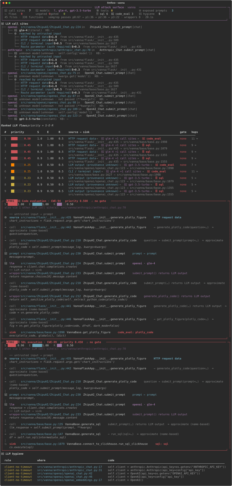
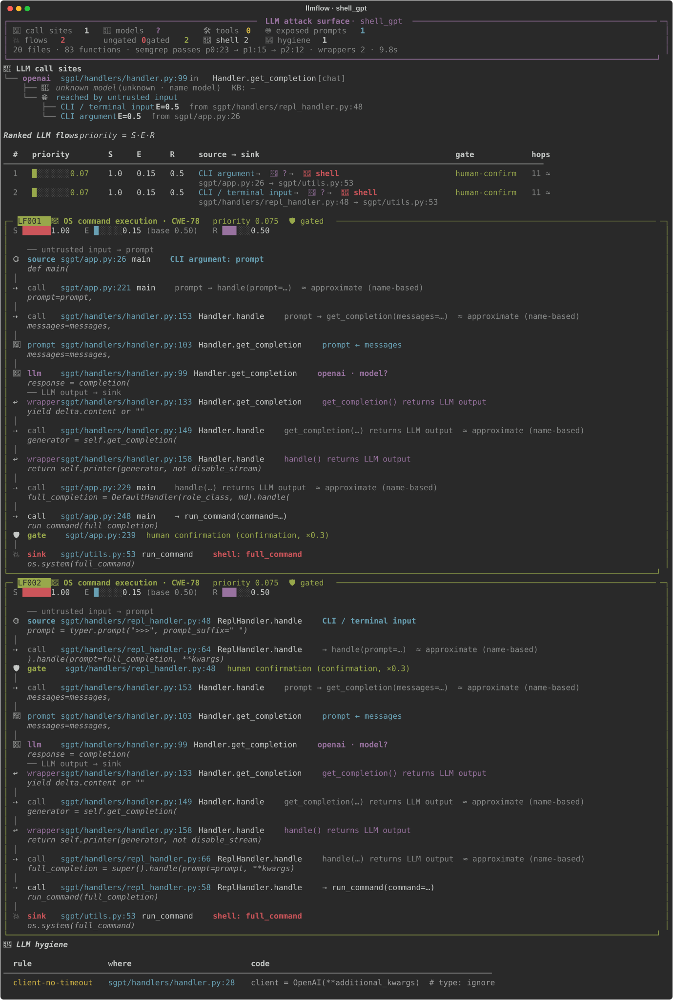
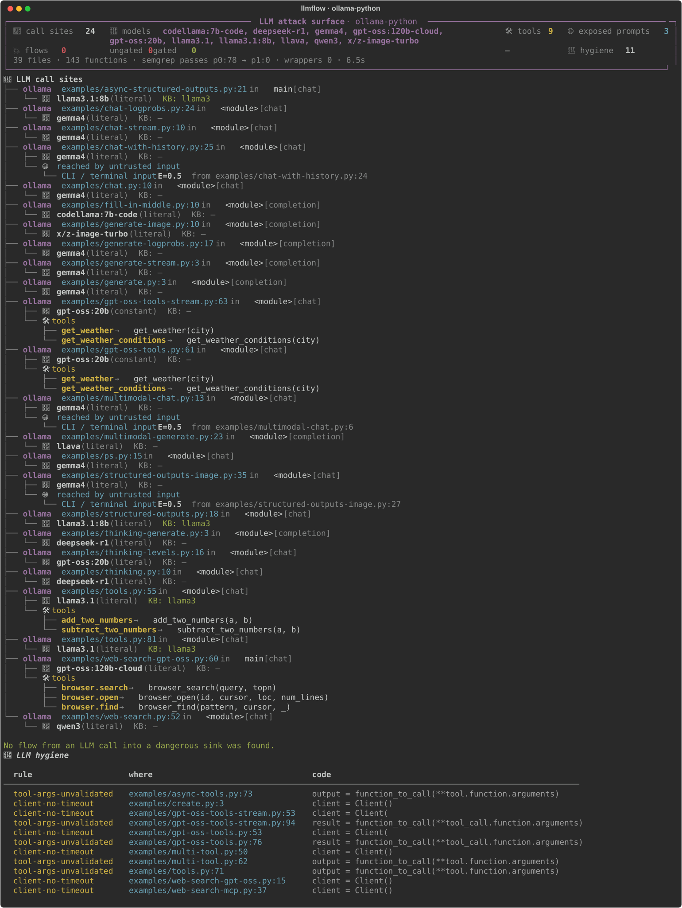
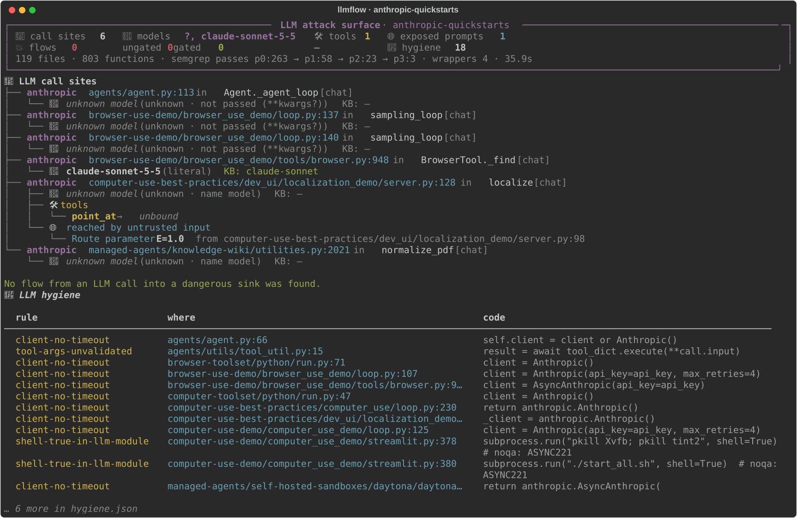
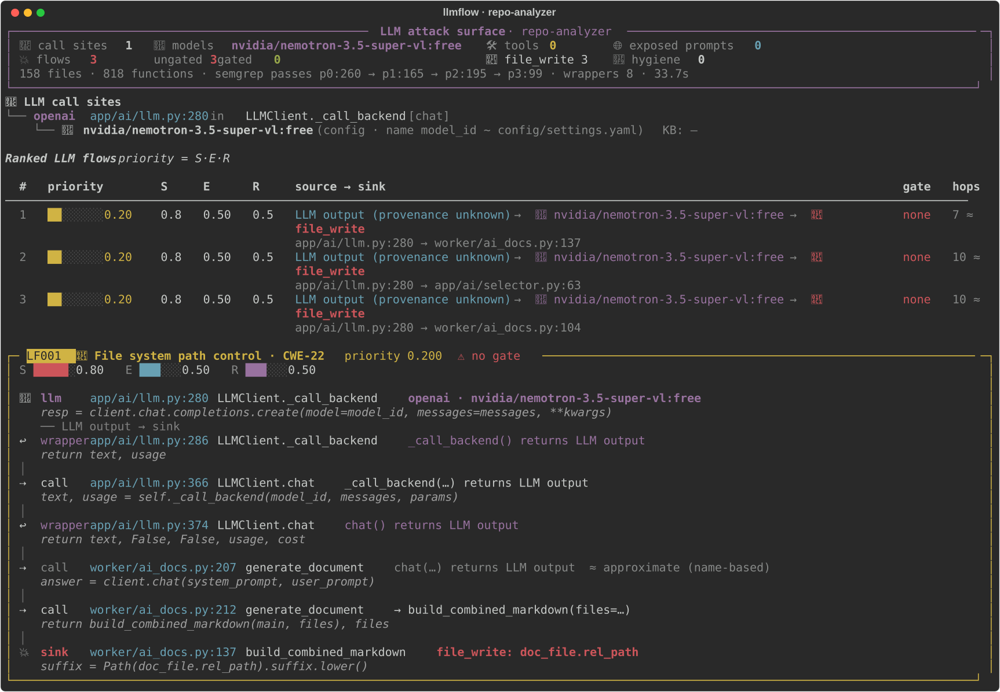

# llmflow on real repositories

Five runs, so you can see what the baseline finds and what it misses.

**Setup**
- The repositories were cloned with `git clone --depth 1` into `data/llmflow/repos/` (gitignored, not part of this repo).
- Scans ran with default options on Windows 11, Python 3.13 and Semgrep 1.187 (native wheel).
- Each run was reproduced with:

  ```powershell
  python -m app llmflow scan data\llmflow\repos\<repo> --svg docs\llmflow\img\<repo>.svg --mermaid docs\llmflow\img\<repo>.md
  ```

| Repository @ ref | Files / functions | LLM call sites | Flows (gated) | Top finding | Time |
|---|---|---|---|---|---|
| [vanna-ai/vanna](https://github.com/vanna-ai/vanna) @ `v0.5.5` (a72b842) | 45 / 338 | 7 | 9 (0) | HTTP request → LLM → **`exec`** (CVE-2024-5565), priority 0.50 | 17 s |
| [TheR1D/shell_gpt](https://github.com/TheR1D/shell_gpt) @ `1.4.3` (6f9d7f6) | 20 / 83 | 1 (SDK alias) | 2 (2) | CLI → LLM → **`os.system`**, 🛡 human confirmation, 0.075 | 9 s |
| [ollama/ollama-python](https://github.com/ollama/ollama-python) @ `main` (29b7d09) | 39 / 143 | 24 | 0 | — (inventory: 9 tools bound to functions) | 7 s |
| [anthropics/anthropic-quickstarts](https://github.com/anthropics/anthropic-quickstarts) @ `main` (4a4224b) | 119 / 803 | 6 | 0 | — (**known miss**: class-based bash tool) | 38 s |
| this repository (`--exclude data --exclude sandbox`) | 158 / 817 | 1 | 3 (0) | LLM answer chooses file paths in AI docs, 0.20 | 38 s |

---

## Vanna 0.5.5: CVE-2024-5565

Vanna turns a question into SQL and a Plotly chart. In [CVE-2024-5565](https://nvd.nist.gov/vuln/detail/CVE-2024-5565), the chart code that the model writes is passed to `exec()`, so a prompt injection in the question becomes remote code execution.

**Plain Semgrep** (`semgrep --config p/python`, 151 rules without login) reports **0 findings** in the repository, including at the `exec` line.

**llmflow** ranks the CVE path as finding **#1**:



```mermaid
flowchart LR
    h0(["🌐 HTTP request data<br/><small>generate_plotly_figure · flask/__init__.py:435</small>"]):::source
    h1["⇢ → generate_plotly_code(question=…)<br/><small>flask/__init__.py:442</small>"]:::call
    h2["⇢ question → submit_prompt(prompt=…)<br/><small>generate_plotly_code</small>"]:::call
    h3[/"💬 prompt ← prompt<br/><small>submit_prompt</small>"/]:::prompt
    h4{{"🤖 LLM backend<br/><small>submit_prompt (+ other backends)</small>"}}:::llm
    h5("↩ submit_prompt() returns LLM output"):::wrapper
    h7("↩ generate_plotly_code() returns LLM output"):::wrapper
    h9["⇢ → get_plotly_figure(plotly_code=…)<br/><small>flask/__init__.py:446</small>"]:::call
    h10[\"💥 exec(plotly_code)<br/><small>VannaBase.get_plotly_figure · base/base.py:1998</small>"/]:::sink
    h0 -.-> h1 -.-> h2 --> h3 --> h4 --> h5 -.-> h7 -.-> h9 --> h10
    classDef source fill:#083344,stroke:#22d3ee,color:#e0f2fe
    classDef prompt fill:#0c4a6e,stroke:#38bdf8,color:#e0f2fe
    classDef llm fill:#4a044e,stroke:#e879f9,color:#fdf4ff
    classDef wrapper fill:#3b0764,stroke:#c084fc,color:#faf5ff
    classDef call fill:#1f2937,stroke:#9ca3af,color:#f9fafb
    classDef sink fill:#450a0a,stroke:#f87171,color:#fef2f2
```

Full graphs: [img/vanna.md](img/vanna.md).

| # | Priority | Flow |
|---|---|---|
| 1 | 0.50 | Flask `request.args` → `generate_plotly_code` → `submit_prompt` → LLM → `exec` (**the CVE**) |
| 2–4 | 0.45 | Flask `request.args` → `generate_sql` → LLM → `run_sql` → `pd.read_sql_query` / `cursor.execute` (SQLite, Postgres and other backends) |
| 5–9 | 0.23–0.25 | the same sinks from `VannaBase.ask()` (CLI input or unknown provenance) |

Three mechanisms made this work. Each is described in [stitching.md](stitching.md):
- **Polymorphic names.** Vanna defines `submit_prompt` once per LLM backend: OpenAI, Anthropic, Ollama, ZhipuAI, and others. That's more than the call-graph ambiguity limit, but every definition is a method, so it is treated as an interface. The variants are collapsed, and the finding shows `+N call sites`.
- **Aliases.** SQL backends are wired as `self.run_sql = run_sql_sqlite`. Calls through `run_sql` reach the inner function that runs `pd.read_sql_query(sql, conn)`.
- **Route parameters and request sources.** The Flask handler's `request.args.get("chart_instructions")` reaches the prompt through two wrapper levels.

## shell_gpt 1.4.3: gated shell execution

shell_gpt turns a request into a shell command and runs it after asking `[E]xecute, [D]escribe, [A]bort`. Both paths (one-shot `main` and the REPL `e` command) are found and marked gated:



| Flow | Gate | E | Priority |
|---|---|---|---|
| CLI prompt → `Handler.handle` → `get_completion` → LLM → `run_command` → `os.system` | `typer.prompt("[E]xecute…")` | 0.5 × 0.3 = 0.15 | 0.075 |
| REPL input → same → `run_command` | REPL `prompt == "e"` | 0.15 | 0.075 |

Two things were needed here:
- **SDK alias.** shell_gpt never calls `client.chat.completions.create(...)` directly: it binds `completion = client.chat.completions.create` at module level. The inventory finds the alias and adds `completion(...)` as a call site.
- **Generator.** `get_completion` streams with `yield delta.content`, and llmflow counts `yield` as returning LLM output.

## ollama-python: inventory and tools

The examples contain no dangerous flow, which is the expected result. The inventory shows:
- 24 call sites, every model resolved (22 literals, 2 constants);
- tools passed as Python functions (`tools=[add_two_numbers, …]`) and bound to their parameters;
- 11 hygiene findings, such as `tool-args-unvalidated` for `fn(**tool_call.function.arguments)`.



An earlier version flagged `f.write(base64.b64decode(response.image))` as a file-write sink. That writes model *content* to a fixed path, so content writes now belong to the off-by-default `text` class, and `file_write` means the model chooses the *path*.

## anthropic-quickstarts: known miss

`computer-use-demo` gives Claude a bash tool. The command reaches `asyncio.create_subprocess_shell` in `BashTool`, but tools are declared as classes collected in a `ToolCollection` (`tools=self.tool_collection.to_params()`). The inventory resolves only `tools=` literals, Python functions and dispatch dicts, so the tool is not bound and **no flow is reported**.

This is the main gap to close next: class-based tools, then LangChain `@tool` and MCP.

The run still gives:
- 6 call sites;
- a route parameter reaching a prompt in `dev_ui/localization_demo/server.py`;
- 18 hygiene findings (15 `client-no-timeout`, 2 `shell-true-in-llm-module`, 1 `tool-args-unvalidated`).

Models passed through `**kwargs` stay `unknown` rather than being guessed from an unrelated config file.



## This repository (smoke test)

llmflow on its own host project, `--exclude data --exclude sandbox`:
- **1 call site**: `app/ai/llm.py:280`. The model is resolved through `model_id` and `config/settings.yaml` as `nvidia/nemotron-3.5-super-vl:free`.
- **3 flows, priority 0.20, unknown provenance.** In the AI-documents worker (`worker/ai_docs.py`, `app/ai/selector.py`), the model's answer is parsed into file entries whose `rel_path` is used to build paths.

These are review candidates, not confirmed bugs. If the generated paths are only used inside a zip archive, the impact is limited, but a `path-confine` gate (for example `is_relative_to`) would document that.



## Not run here

- **LangChain CVE-2023-29374** (`LLMMathChain` → `eval`): LangChain is not in the MVP SDK catalog. Expected miss.
- **Adversarial-comment smoke test** and **recall@k vs. S-only / plain LLM**: WP12, not part of this baseline. `findings.json` already carries `rank` and `rank_by_S` for it.
