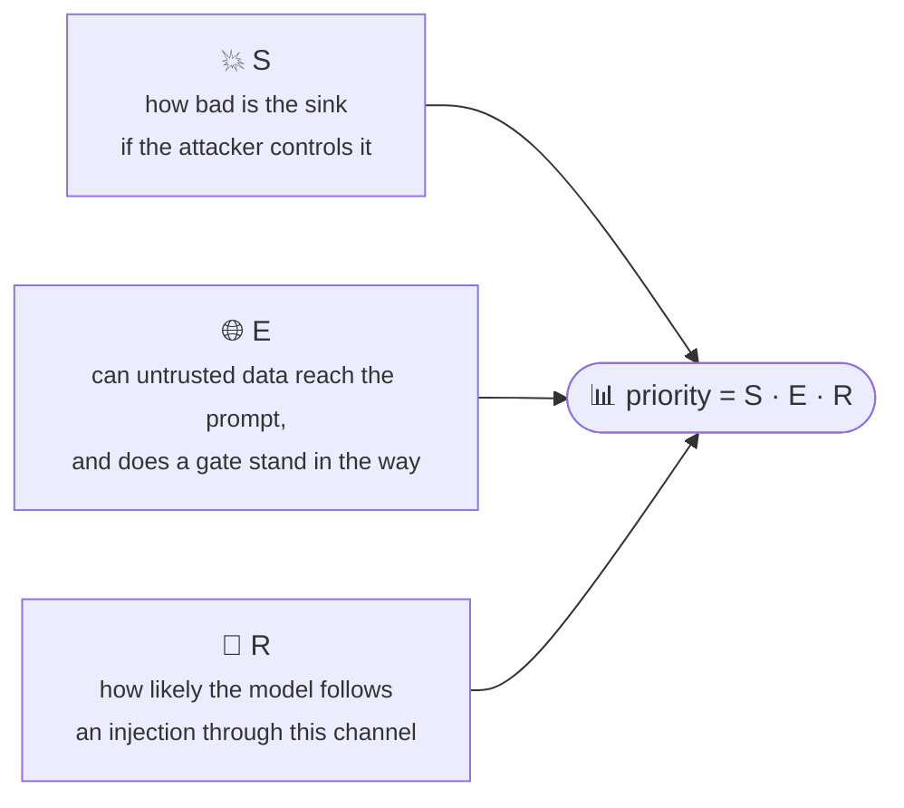

# Scoring: priority = S · E · R

$$\text{priority} = S_{\text{sink}} \cdot E_{\text{exposure}} \cdot R_{\text{model,channel}}$$

This is a **ranking heuristic, not a probability**. Its only job is to put the flows an auditor should read first at the top. Every flow keeps `rank` (by S·E·R) and `rank_by_S` (by sink severity alone), so an evaluation can check whether S·E·R actually improves recall@k over S.



## S: sink severity

| Class | S |
|---|---|
| shell, code_eval | 1.0 |
| sql, deserialize | 0.9 |
| file_write (path control) | 0.8 |
| http | 0.7 |
| html | 0.5 |
| text (off by default) | 0.1 |

## E: exposure

```
E = E_base × min(factor of the gates on the path)       (1.0 when there is no gate)
```

`E_base` comes from the untrusted source that reaches the **same LLM call site** as the flow. When several sources reach it, the one in a function on the flow's own path is preferred (the same request handler), then the highest E.

| Source | E_base |
|---|---|
| HTTP request, fetched web page, retrieved document, web UI input, uploaded file, route parameter | 1.0 |
| CLI / terminal input, local file | 0.5 |
| route parameter behind login/auth/admin decorators | 0.3 |
| no untrusted source found (unknown provenance) | 0.5 |

| Gate kind | Factor | Examples |
|---|---|---|
| deterministic | 0.05 | allowlist check, `shlex.quote`, `html.escape`/`bleach`, read-only DB connection, `sqlglot` statement check, path confinement, schema validation |
| confirmation | 0.3 | `click.confirm`, `typer.prompt`, `if input(...) == "y"` |
| weak | 0.6 | `.startswith("SELECT")`, `re.match` |

## R: model and channel

R is looked up in `config/llmflow/kb.yaml` by the model name the inventory resolved:
- default 0.5;
- clamped to `[0.3, 0.9]`;
- unknown models get the default.

In this baseline every model has R = 0.5, so R does not change the order yet. It is wired through so that robustness numbers can be added per model and channel (`chat`, `completion`, `responses`, `tool_call`) without code changes.

## Worked example

These two flows come from the fixture in `tests/llmflow/test_pipeline_semgrep.py::test_cross_file_wrapper_and_gated_variant`:

```python
@app.route("/open")
def open_ep():
    cmd = ask(request.args.get("q"))        # ask() wraps client.chat.completions.create
    return run_cmd(cmd)                      # run_cmd → subprocess.run(cmd, shell=True)

@app.route("/safe")
def safe_ep():
    cmd = ask(request.args.get("q"))
    if cmd.split()[0] not in ALLOWED:        # 🛡 allowlist (deterministic)
        return "no"
    return run_cmd(cmd)
```

| Flow | S | E_base | gate factor | E | R | priority |
|---|---|---|---|---|---|---|
| `/open`: request → `ask` → LLM → `run_cmd` → shell | 1.0 | 1.0 (HTTP request) | — | 1.0 | 0.5 | **0.500** |
| `/safe`: same, behind the allowlist | 1.0 | 1.0 | 0.05 | 0.05 | 0.5 | **0.025** |

Both flows are reported. The gated one is kept, so an auditor can check the gate, but it is marked 🛡 and ranked at the bottom.

## Limits

- **Gates are pattern matches.** An allowlist check on the wrong variable that happens to share an identifier with the sink argument counts as a gate. A custom validator function doesn't count. `shlex.quote` on a string that is then passed to `bash -c` is treated as a gate although it is not one.
- **E_base is attached per LLM call site, not per path.** When one call site serves several handlers, the best-matching source is picked as described above.
- **Unknown provenance is 0.5, not 0.** Indirect prompt injection (data the model reads elsewhere) is possible even when no source was found.
- **R is constant** until the KB carries robustness data.
