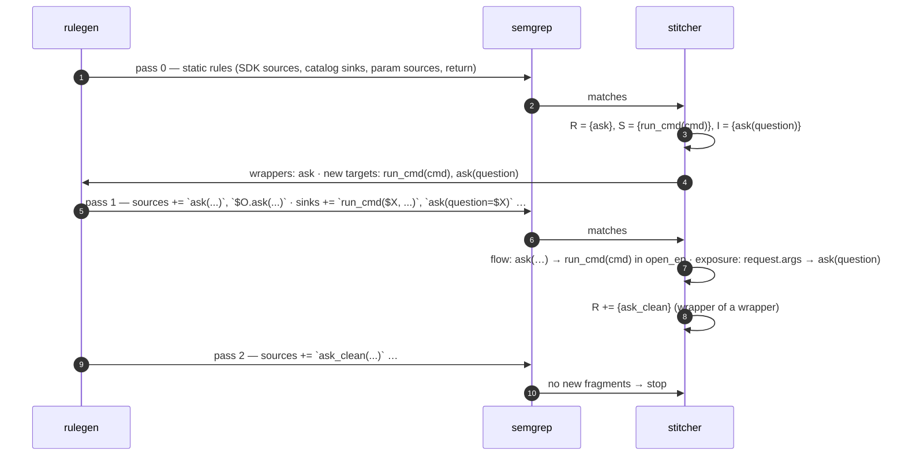

# Stitching flows across functions

**Problem.** Semgrep CE (the open-source engine) tracks taint inside one function. Cross-function and cross-file taint is in the paid Pro engine. Real LLM apps almost never call the SDK and the sink in the same function: there is an `ask()` wrapper in `llm.py`, a request handler in `web.py` and a `run_cmd()` helper somewhere else.

**Approach.** llmflow keeps Semgrep for what it does well, intra-function taint, and joins the pieces itself:
- the joins use the analyzer's code index (`app/context/index.py`, `callgraph.py`, `entrypoints.py`);
- a fixpoint over generated rules repeats the join until nothing new appears.

A second obstacle is that Semgrep CE also gives **no dataflow traces** without a login. So the generated rules carry what they need in the message: `taint_unify_mvars: true` lets a taint rule's message reference source metavariables, e.g. `@@F=$LS_F@@P=$LS_P@@X=$X@@`.

## Fragments

Each pass records three kinds of per-function facts:

| Fact | Meaning | Found by |
|---|---|---|
| **R(f)** | `f` returns LLM output (or `yield`s it) | `llmflow.o2s.return`: source = SDK call or known wrapper, sink = `return $X` / `yield $X` |
| **S(f, p)** | parameter `p` of `f` reaches a dangerous sink | `llmflow.par.sink.<class>` and `llmflow.par.fn.S.*`: source = `def $F(..., $P, ...)` |
| **I(f, p)** | parameter `p` of `f` reaches a prompt | `llmflow.par.prompt` and `llmflow.par.fn.I.*` |

Plus two kinds of end results:
- **flows**: LLM output reaching a sink, or reaching an argument of an S function;
- **exposures**: an untrusted source reaching a prompt, or reaching an argument of an I function.

## The fixpoint



Each pass generates only the rules involving something new:
- when the wrapper set grew, it adds `o2s` rules from all wrappers to every sink, to `return`, and to every S function;
- otherwise it adds `o2s` rules only to the new S functions;
- `i2p` rules go to new I functions and `par` rules to all new targets.

The loop stops when a pass finds nothing new, or at `--max-depth` (default 3).

Hop chains are kept on every fact, so the final flow shows the whole path:

```
🌐 source   web.py:15  run_endpoint   q = request.args.get("q")
⇢  call     web.py:16  run_endpoint   → ask_clean(question=…)
⇢  call     llm.py:18  ask_clean      question → ask(question=…)
💬 prompt   llm.py:11  ask            prompt ← question
🤖 llm      llm.py:9   ask            openai · gpt-4o-mini
↩  wrapper  llm.py:14  ask            ask() returns LLM output
⇢  call     llm.py:18  ask_clean      ask(…) returns LLM output
↩  wrapper  llm.py:19  ask_clean      ask_clean() returns LLM output
⇢  call     web.py:16  run_endpoint   ask_clean(…) returns LLM output
⇢  call     web.py:17  run_endpoint   → run_command(cmd=…)
💥 sink     web.py:10  run_command    subprocess.run(cmd, shell=True)
```

Tools close the agent case. The inventory binds each declared tool to a function, and that function's parameters are chosen by the model. So any S fact on a tool parameter becomes a flow on the `tool_call` channel:

```
🤖 llm   agent.py:20  ollama · llama3.1
🛠 tool  agent.py:7   tool shell(command) ← model
💥 sink  agent.py:8   os.popen(command)
```

## Resolving names

Calls are matched by name (`f(...)`, `$O.f(...)`). Several mechanisms resolve and constrain these names:

| Mechanism | What it handles |
|---|---|
| Code index (`MAX_TARGETS = 5`) | a name with more definitions than this is dropped as too ambiguous… |
| Polymorphic names | …unless every definition is a method: one `submit_prompt` per LLM backend class (Vanna) is an interface, not noise |
| Aliases | `self.run_sql = run_sql_sqlite`: calls through `run_sql` reach `run_sql_sqlite` (Vanna's SQL backends) |
| SDK aliases | `completion = client.chat.completions.create` (shell_gpt) |
| Consistent positions | positional sinks (`f($X, ...)`) are used only when every same-named definition has the parameter at that position; otherwise keyword-only |
| Generic names | `get`, `run`, `execute`, `query`, `create`, … are never used as wrapper names |
| `exact: true` on LLM sources | the arguments of an SDK/wrapper call are not its output |
| Collapsing | variants of one finding that differ only in which LLM backend sits in between are folded into one (`+N call sites`) |

Every edge resolved through an ambiguous name is marked **≈** in the terminal and drawn dashed in Mermaid.

## Known misses

| Pattern | Why | Example |
|---|---|---|
| Taint through `self.attr` across methods | Semgrep fields are per function; the stitcher has no field model | `self.cmd = llm(); … run(self.cmd)` in another method |
| Containers across functions | the stitcher passes whole values, not elements | a list of commands built in one function and executed in another |
| Class-based tool collections | the inventory only resolves `tools=` literals, functions and dispatch dicts | anthropic-quickstarts `ToolCollection` → `BashTool.__call__` |
| Frameworks | not in the SDK catalog | LangChain chains / `@tool`, LlamaIndex, MCP servers |
| Dynamic dispatch | `getattr(obj, name)(...)`, `globals()[name]` | |
| Callbacks / decorators that call the wrapped function | name-based edges only | |
