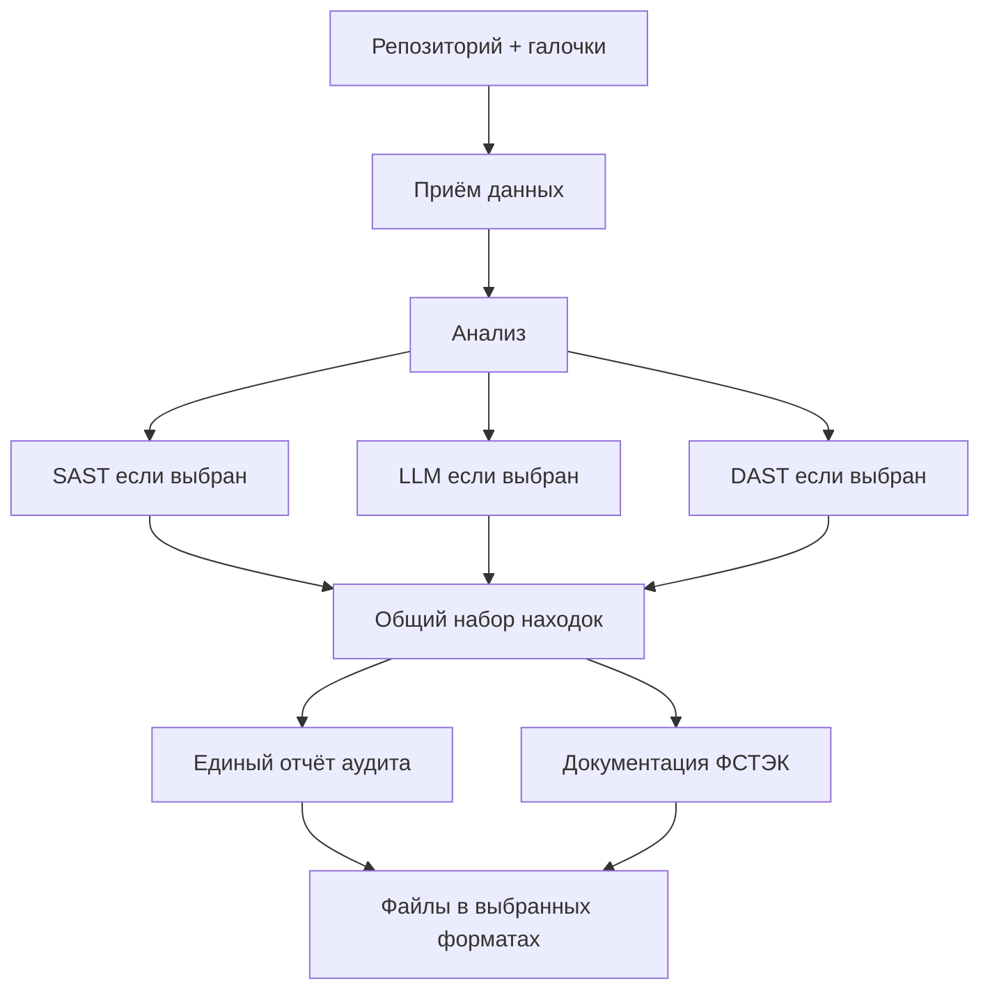
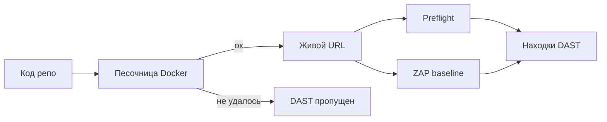

# Как устроен аудит репозитория

Документ по смыслу процесса: что выбирается в форме, что реально запускается и что получается на выходе. Без деталей кода.

> **Интеграция secaudit (PR #3):** расширенный SAST / context / LLM triage — это
> реализация runners `static` и `ai` внутри уже существующего UI. Галочки методов
> и форматов остаются контрактом; отдельный UI под secaudit не вводится.
> Служебные артефакты (`data/.../secaudit/`, `audit_report.md`) не появляются
> как кнопки на странице скана. CLI/bench (`python -m app`, `python -m bench`,
> `docs/REPORT.md`, `docs/BENCHMARK.md`) — отдельный контур, на UI-контракт
> не влияют.

---

## Коротко

1. Вы отдаёте репозиторий (ссылка GitHub или zip/файлы).
2. Отмечаете **методы анализа** (что проверить) и **форматы** (в каком виде забрать результат).
3. Система по очереди запускает только выбранные методы.
4. Все находки складываются в **один отчёт аудита** (с секциями по методам) плюс **документация ФСТЭК** — оба в выбранных форматах.

---

## 1. Что вы сдаёте

| Способ | Что происходит |
|---|---|
| Ссылка на репозиторий | Система клонирует код |
| Zip / папка файлов | Система принимает загрузку и раскладывает исходники |

Дальше работа идёт уже с локальной копией проекта.

---

## 2. Что вы выбираете в форме

### Методы анализа — *что проверять*

| Галочка | Смысл |
|---|---|
| **SAST** | Статический разбор исходников (без запуска приложения) |
| **LLM-агент** | ИИ смотрит отобранные файлы и ищет проблемы поверх/вместо «сухих» правил |
| **DAST** | Поднять приложение в песочнице и прогнать динамическую проверку |
| **Пентест** | Пока запланировано, в работе не участвует |

По умолчанию включён только SAST. Можно комбинировать: например SAST + DAST или SAST + LLM.

### Форматы — *в каком виде отдать результат*

Выбранные форматы применяются сразу к двум документам:

- **Отчёт аудита** — единый отчёт с секциями по методам  
- **Документация ФСТЭК** — черновик документации по результатам  

Доступны: Markdown, HTML, PDF, Word.

Отдельной кнопки «Отчёт DAST» больше нет: находки DAST живут внутри отчёта аудита в своей секции.

---

## 3. Порядок анализа

Методы идут **последовательно**, не параллельно. Неотмеченный метод просто пропускается.

### Шаг A. SAST — статический анализ

**Когда:** отмечен SAST.

**Что внутри (для Python-проектов):**

1. **Инвентаризация кода** — сколько файлов/модулей/классов/функций, зависимости.
2. **Общий SAST-движок (SARIF)** — по умолчанию **Bandit** и **Semgrep** (правила Python / OWASP). Нет бинаря или сбой инструмента — он помечается как пропуск/ошибка, остальные продолжают работу.
3. **pip-audit** — известные уязвимости в зависимостях из `requirements.txt` / lock-файлов.
4. **Контекст кода** (дерево вызовов, точки входа, sinks) пишется в служебный каталог `secaudit/` рядом с отчётом — в кнопки UI не попадает.

**Результат шага:** список находок (в т.ч. слитые совпадения нескольких инструментов) + инвентаризация. Приложение при этом не запускается.

---

### Шаг B. LLM-агент

**Когда:** отмечен LLM-агент. Без этой галочки вызовов к модели **нет**.

**Что внутри (режимы из настроек, обычно все три):**

1. **Triage** — вердикты по находкам SAST (подтвердить / отклонить ложное), если статика уже что-то нашла и есть контекст кода.
2. **Discovery** — поиск новых проблем от точек входа и опасных вызовов (с подсказками от SAST, если они были).
3. **Review** — прежний просмотр отобранных файлов (ограниченный набор, не весь репозиторий).

Находки ИИ помечаются источником семейства `ai` / `ai-discovery`, чтобы в отчёте они лежали в секции LLM, а не смешивались с Bandit/Semgrep. Отклонённые triage’ом ложные срабатывания в активной секции не показываются (или помечены как отклонённые).

Сбои сети/квоты модели — soft-fail: скан не валится, отчёт собирается по тому, что успело.

---

### Шаг C. DAST — динамический анализ

**Когда:** отмечен DAST.

**Что внутри:**

1. **Песочница (Docker)** — попытка автоматически понять, как поднять приложение из репозитория, и запустить его в изолированном контейнере (для старых demo-зависимостей подтягиваются совместимые пакеты вроде `six` / старых `markupsafe`).
2. Если подъём удался:
   - **Preflight** — быстрые проверки живого URL (доступность, базовые признаки проблем безопасности на HTTP-уровне).
   - **ZAP baseline** — сканер OWASP ZAP по поднятому приложению (типовые web-уязвимости / misconfig).
3. Если песочницу поднять нельзя (нет Dockerfile/способа запуска, Docker выключен и т.д.) — DAST помечается как пропущенный, **SAST/LLM при этом не откатываются**.

**Результат шага:** находки динамического анализа + метаданные (URL цели, статус). Они попадают в общую кучу находок и в секцию DAST единого отчёта.

---

## 4. Что получается в конце

Все выбранные методы складывают находки в один результат. Дальше формируются документы:

| Документ | Содержание |
|---|---|
| **Отчёт аудита** | Сводка + секции **SAST / LLM / DAST** (только те методы, что были в заявке) + находки и рекомендации |
| **Документация ФСТЭК** | Черновик «паспорт / инвентаризация / протокол / выводы» по тому же результату |

Что нужно смотреть на практике:

- **Отчёт аудита** — основной результат (все методы в одном месте).
- **Документация ФСТЭК** — отдельно, если готовите пакет документов.
- Кнопки **MD / PDF** у каждого документа — те же тексты для скачивания; отдельного «отчёта DAST» нет.

Файлы появляются **только в отмеченных форматах**, например:

- выбрали HTML + PDF → `report.html`, `report.pdf`, `doc.html`, `doc.pdf`
- выбрали только Markdown → `report.md`, `doc.md`

Сбой одного формата (например PDF на огромном отчёте) не должен ронять остальные: HTML/MD всё равно появятся, если их выбирали.

### Как выглядит HTML-отчёт аудита

- Секции **SAST / LLM / DAST** — **сворачиваемые** списки (с счётчиком находок в заголовке).
- Длинные описания (часто у ZAP) — свёрнуты до превью, по клику «Показать полностью»; сырой HTML из сканеров в текст не торчит.
- Длинные строки без пробелов переносятся, чтобы не уезжать за край карточки.
- Внутри секций могут быть краткие пометки: инструменты SAST, статус LLM, цель и статус DAST, ранжирование (например `S+T+D` — статика + triage + discovery).

Стадии на экране заявки:

1. **Приём данных** — репозиторий принят  
2. **Анализ** — SAST / LLM / DAST по галочкам  
3. **Формирование отчёта** — сборка файлов  

---

## 5. Типовые сценарии

| Галочки | Что произойдёт |
|---|---|
| Только SAST + MD | Bandit + Semgrep + pip-audit + контекст → отчёт и ФСТЭК в Markdown (секция только SAST) |
| SAST + LLM + HTML | Статика, затем triage/discovery/review → один HTML с секциями SAST и LLM + ФСТЭК HTML |
| SAST + DAST + PDF | Статика, затем Docker и ZAP/preflight → отчёт с секциями SAST и DAST (+ ФСТЭК) |
| SAST + LLM + DAST | Полный конвейер; в HTML три сворачиваемых секции |
| Только DAST | Статика не гоняется; песочница и динамика (без полного SAST-контура) |
| Только LLM | Без static: по возможности строится контекст кода, затем ИИ; секция только LLM |

---

## 6. Важные оговорки

- Результаты **рекомендательные**: возможны пропуски и ложные срабатывания.
- DAST зависит от того, удаётся ли автоматически поднять приложение; иначе секция DAST будет с статусом «пропущено/ошибка», но остальные методы остаются валидными.
- Отдельный инструмент SAST (например Semgrep на Windows) может упасть из‑за окружения — это soft-fail, Bandit и остальное всё равно дают находки.
- Документация ФСТЭК — **черновик для подготовки материалов**, не готовый сертифицированный комплект.
- Пентест в интерфейсе пока недоступен («запланировано»).
