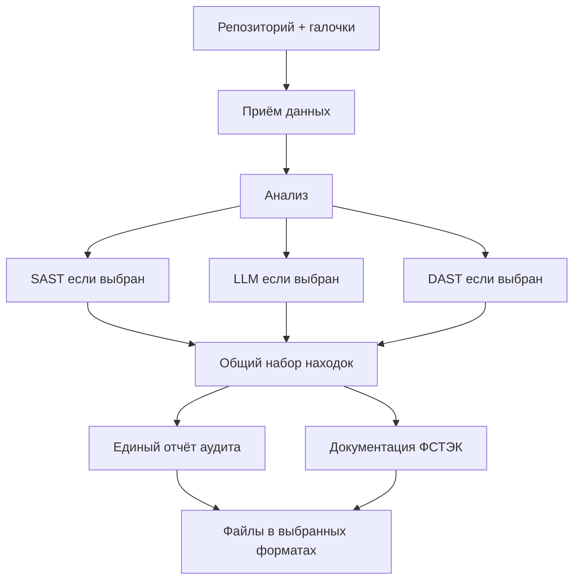
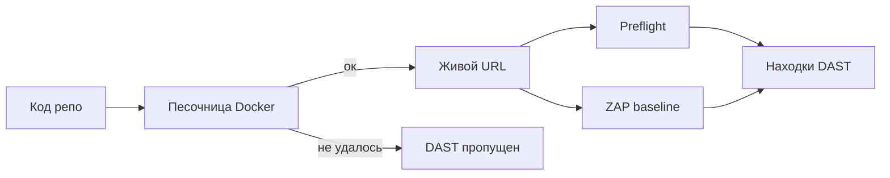

# Как устроен аудит репозитория

Документ по смыслу процесса: что выбирается в форме, что реально запускается и что получается на выходе. Без деталей кода.

---

## Коротко

1. Вы отдаёте репозиторий (ссылка GitHub или zip/файлы).
2. Отмечаете **методы анализа** (что проверить) и **форматы** (в каком виде забрать результат).
3. Система по очереди запускает только выбранные методы.
4. Все находки складываются в **один отчёт аудита** (с секциями по методам) плюс **документация ФСТЭК** — оба в выбранных форматах.

---

## 1. Что вы сдаёте

| Способ | Что происходит |
|---|---|
| Ссылка на репозиторий | Система клонирует код |
| Zip / папка файлов | Система принимает загрузку и раскладывает исходники |

Дальше работа идёт уже с локальной копией проекта.

---

## 2. Что вы выбираете в форме

### Методы анализа — *что проверять*

| Галочка | Смысл |
|---|---|
| **SAST** | Статический разбор исходников (без запуска приложения) |
| **LLM-агент** | ИИ смотрит отобранные файлы и ищет проблемы поверх/вместо «сухих» правил |
| **DAST** | Поднять приложение в песочнице и прогнать динамическую проверку |
| **Пентест** | Пока запланировано, в работе не участвует |

По умолчанию включён только SAST. Можно комбинировать: например SAST + DAST или SAST + LLM.

### Форматы — *в каком виде отдать результат*

Выбранные форматы применяются сразу к двум документам:

- **Отчёт аудита** — единый отчёт с секциями по методам  
- **Документация ФСТЭК** — черновик документации по результатам  

Доступны: Markdown, HTML, PDF, Word.

Отдельной кнопки «Отчёт DAST» больше нет: находки DAST живут внутри отчёта аудита в своей секции.

---

## 3. Порядок анализа

Методы идут **последовательно**, не параллельно. Неотмеченный метод просто пропускается.

### Шаг A. SAST — статический анализ

**Когда:** отмечен SAST.

**Что внутри (для Python-проектов):**

1. **Инвентаризация кода** — сколько файлов/модулей/классов/функций, зависимости.
2. **Bandit** — поиск опасных паттернов в коде (инъекции, небезопасная криптография и т.п.).
3. **pip-audit** — известные уязвимости в зависимостях из `requirements.txt` / lock-файлов.

**Результат шага:** список находок + инвентаризация. Приложение при этом не запускается.

---

### Шаг B. LLM-агент

**Когда:** отмечен LLM-агент.

**Что внутри:**

1. По инвентаризации (и уже найденному) **отбирается ограниченный набор файлов** — самые релевантные, не весь репозиторий целиком.
2. Файлы и контекст уходят в языковую модель.
3. Модель возвращает подозрения; система принимает только то, что привязано к реально отправленным файлам (без «выдуманных» путей).

**Результат шага:** дополнительные находки с источником «ИИ».  
Это эвристика, не сертификационный вывод.

Если LLM не отмечен — этот шаг не выполняется.

---

### Шаг C. DAST — динамический анализ

**Когда:** отмечен DAST.

**Что внутри:**

1. **Песочница (Docker)** — попытка автоматически понять, как поднять приложение из репозитория, и запустить его в изолированном контейнере.
2. Если подъём удался:
   - **Preflight** — быстрые проверки живого URL (доступность, базовые признаки проблем безопасности на HTTP-уровне).
   - **ZAP baseline** — сканер OWASP ZAP по поднятому приложению (типовые web-уязвимости / misconfig).
3. Если песочницу поднять нельзя (нет Dockerfile/способа запуска, Docker выключен и т.д.) — DAST помечается как пропущенный, **SAST/LLM при этом не откатываются**.

**Результат шага:** находки динамического анализа + метаданные (URL цели, статус). Они попадают в общую кучу находок и в секцию DAST единого отчёта.

---

## 4. Что получается в конце

Все выбранные методы складывают находки в один результат. Дальше формируются документы:

| Документ | Содержание |
|---|---|
| **Отчёт аудита** | Сводка + секции **SAST / LLM / DAST** (только те, что реально запускались) + список находок и рекомендаций |
| **Документация ФСТЭК** | Черновик «паспорт / инвентаризация / протокол / выводы» по тому же результату |

Файлы появляются **только в отмеченных форматах**, например:

- выбрали HTML + PDF → `report.html`, `report.pdf`, `doc.html`, `doc.pdf`
- выбрали только Markdown → `report.md`, `doc.md`

Стадии на экране заявки:

1. **Приём данных** — репозиторий принят  
2. **Анализ** — SAST / LLM / DAST по галочкам  
3. **Формирование отчёта** — сборка файлов  

---

## 5. Типовые сценарии

| Галочки | Что произойдёт |
|---|---|
| Только SAST + MD | Bandit + pip-audit + инвентаризация → отчёт и ФСТЭК в Markdown |
| SAST + LLM + HTML | Сначала статика, потом ИИ по отобранным файлам → один HTML-отчёт с двумя секциями + ФСТЭК HTML |
| SAST + DAST + PDF | Сначала статика, потом подъём в Docker и ZAP/preflight → PDF отчёта с секциями SAST и DAST (+ ФСТЭК PDF) |
| Только DAST | Статика не гоняется; идёт попытка песочницы и динамика (инвентаризация для LLM при этом тоже не строится «как для SAST») |

---

## 6. Важные оговорки

- Результаты **рекомендательные**: возможны пропуски и ложные срабатывания.
- DAST зависит от того, удаётся ли автоматически поднять приложение; иначе секция DAST будет с статусом «пропущено/ошибка», но остальные методы остаются валидными.
- Документация ФСТЭК — **черновик для подготовки материалов**, не готовый сертифицированный комплект.
- Пентест в интерфейсе пока недоступен («запланировано»).
