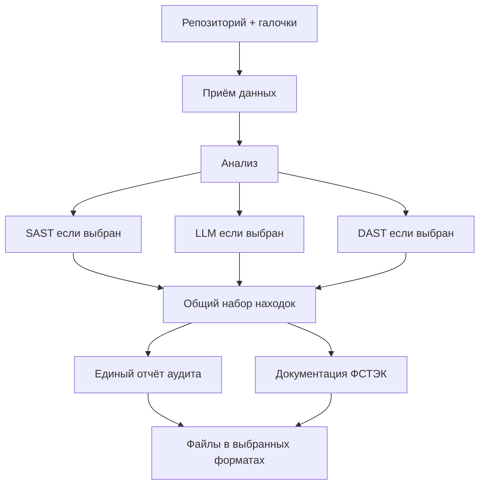
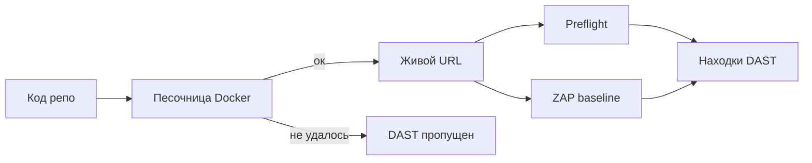

# Как устроен аудит репозитория

Документ по смыслу процесса: что выбирается в форме, что реально запускается и что получается на выходе. Без деталей кода.

Для передачи инженерам (контракты, запуск, чеклист приёмки): [`SPEC.md`](SPEC.md).

> **Текущее состояние:** в продуктовый контур влиты secaudit (SAST/context/LLM triage)
> и доработки UI/DAST/опциональных LLM-документов. Галочки методов и форматов —
> единственный контракт с пользователем; отдельный UI под secaudit не вводится.
> Служебные артефакты (`secaudit/`, SARIF и т.п.) не появляются как кнопки на
> странице скана. CLI/bench (`python -m app`, `python -m bench`) — отдельный
> research-контур, на UI не влияют.

---

## Коротко

1. Вы отдаёте репозиторий (ссылка GitHub или zip/файлы).
2. Отмечаете **методы анализа** и **форматы** результата.
3. Система по очереди запускает только выбранные методы (один воркер — одна заявка за раз).
4. На выходе: **единый отчёт аудита** (секции по методам) + **документация ФСТЭК** в выбранных форматах. Опционально (если включено у воркера) — ещё LLM-протокол ФСТЭК и zip с docs по коду.

---

## 1. Что вы сдаёте

| Способ | Что происходит |
|---|---|
| Ссылка на репозиторий | Система клонирует код |
| Zip / папка файлов | Система принимает загрузку и раскладывает исходники |

Дальше работа идёт уже с локальной копией проекта.

Web и worker обязаны смотреть в **один** каталог `data/` (в конфиге фронта — `../data` от `frontend/`). Если папки разные, заявка «зависает» на этапе анализа: приём уже готов, а воркер задачу не видит.

---

## 2. Что вы выбираете в форме

### Методы анализа — *что проверять*

| Галочка | Смысл |
|---|---|
| **SAST** | Статический разбор исходников (без запуска приложения) |
| **LLM-агент** | ИИ смотрит отобранные файлы / triage / discovery поверх статики |
| **DAST** | Поднять приложение в песочнице и прогнать динамическую проверку (preflight + ZAP) |
| **Пентест** | Гипотезы по коду → проверка на живом приложении → активный агент (пробы SQLi/XSS/CMDi и др.) |

По умолчанию включён только SAST. Можно комбинировать: например SAST + DAST, SAST + Пентест или SAST + LLM.
Тип проверки на странице заявки берётся из **выбранных галочек** (не путать Пентест с DAST).

### Форматы — *в каком виде отдать результат*

Выбранные форматы применяются к **отчёту аудита** и **документации ФСТЭК** (`report.*` и `doc.*`):

- Markdown (`.md`)
- HTML
- PDF  

(Word/DOCX остаётся только для старых уже сгенерированных сканов.)

Отдельной кнопки «Отчёт DAST» нет: находки DAST живут внутри отчёта аудита в своей секции.

---

## 3. Порядок анализа

Методы идут **последовательно**, не параллельно. Неотмеченный метод просто пропускается. Воркер обрабатывает **одну заявку за раз**: пока идёт длинный скан (особенно LLM или DAST), следующая заявка на экране может долго стоять в «Ожидание» на этапе анализа — это очередь, а не поломка UI.

### Шаг A. SAST — статический анализ

**Когда:** отмечен SAST.

**Что внутри (для Python-проектов):**

1. **Инвентаризация кода** — сколько файлов/модулей/классов/функций, зависимости.
2. **Общий SAST-движок (SARIF)** — по умолчанию **Bandit** и **Semgrep**. Нет бинаря или сбой инструмента — он помечается как пропуск/ошибка, остальные продолжают работу.
3. **pip-audit** — известные уязвимости в зависимостях из `requirements.txt` / lock-файлов.
4. **Контекст кода** (дерево вызовов, точки входа, sinks) пишется в служебный каталог `secaudit/` — в кнопки UI не попадает.

**Результат шага:** список находок + инвентаризация. Приложение при этом не запускается.

---

### Шаг B. LLM-агент

**Когда:** отмечен LLM-агент. Без этой галочки вызовов к модели **нет**.

**Что внутри (режимы из настроек, обычно все три):**

1. **Triage** — вердикты по находкам SAST (подтвердить / отклонить ложное).
2. **Discovery** — поиск новых проблем от точек входа и опасных вызовов.
3. **Review** — просмотр отобранных файлов (ограниченный набор).

Находки ИИ — источник семейства `ai` / `ai-discovery` (секция LLM). Отклонённые triage’ом FP в активной секции не показываются. Сбои сети/квоты — soft-fail: скан не валится.

---

### Шаг C. DAST — динамический анализ

**Когда:** отмечен DAST. Нужен **запущенный Docker**.

**Что внутри:**

1. **Песочница (Docker / compose)** — попытка поднять приложение из репозитория в изолированном контейнере.
2. Если подъём удался:
   - **Preflight** — быстрые проверки живого URL;
   - **ZAP baseline** — сканер OWASP ZAP по поднятому приложению.
3. Если песочницу поднять нельзя — DAST помечается как пропущенный, **SAST/LLM не откатываются**.

При запуске воркера в Docker важны общие том/сокет и хосты `SANDBOX_*` / `ZAP_*` (см. `docker-compose.yml` и [`SPEC.md`](SPEC.md)): отчёт ZAP и доступ к цели иначе «невидимы» из контейнера воркера.

**Результат шага:** находки + метаданные (URL, статус) → секция DAST единого отчёта.

---

### Шаг D. Пентест

**Когда:** отмечен **Пентест** (runner `manual`). Нужен Docker для песочницы (как у DAST).

**Что внутри:**

1. **Ревью кода → гипотезы** уязвимостей (SAST-находки + эвристики / LLM при наличии ключа).
2. **Песочница** — подъём приложения (без обязательного ZAP, если DAST не отмечен).
3. **Проверка гипотез** HTTP-пробами (плагины × стратегии) + опциональный LLM-judge.
4. **Активный агент** — crawl поверхности и точечные пробы (SQLi/XSS/CMDi/…).

Находки попадают в секцию **«Пентест»** отчёта (`source=pentest|llm-review|review-agent`).  
Подробнее: [`PENTEST_AGENT_OVERVIEW.md`](PENTEST_AGENT_OVERVIEW.md), [`SECURITY_PIPELINE.md`](SECURITY_PIPELINE.md).

---

## 4. Что получается в конце

| Документ | Содержание | Когда появляется |
|---|---|---|
| **Отчёт аудита** (`report.*`) | Сводка + секции **SAST / LLM / DAST / Пентест** по галочкам | Сразу после анализа (по выбранным форматам) |
| **Документация ФСТЭК** (`doc.*`) | Черновик «паспорт / инвентаризация / протокол / выводы» | Вместе с основным отчётом |
| **Протокол исследований ФСТЭК** (`fstec.*`) | Отдельный LLM-документ по методике | После отчёта, если `ai_documents.enabled` |
| **Документация к коду** (`codedocs.zip`) | Zip-набор файлов от LLM | После отчёта, если `ai_documents.enabled` |

**Порядок публикации:** сначала `report`/`doc` → этап «Формирование отчёта» становится **Готово** и UI показывает отчёт; затем дописываются `fstec` / `codedocs.zip` (манифест обновляется по мере готовности каждого документа). Ошибка LLM даёт **placeholder**, кнопка ZIP всё равно появляется.

AI-документы включаются в [`worker/config/worker.yaml`](../worker/config/worker.yaml) (`ai_documents.enabled`, по умолчанию `true` в этой ветке) или через `WORKER_ENABLE_AI_DOCUMENTS`. Промпт ограничен (топ findings + отобранные файлы, ≤ ~80k символов), таймаут ~120 с — чтобы free OpenRouter не «съедал» контекст и не держал очередь по 15 минут на один вызов.

Сбой одного формата (например PDF) не роняет остальные: HTML/MD всё равно появятся, если их выбирали.

### Как выглядит страница заявки

1. **Приём данных** — репозиторий принят (делает web сразу).
2. **Анализ** — SAST / LLM / DAST / Пентест по галочкам (делает worker).
3. **Формирование отчёта** — сначала основные файлы, затем опциональные LLM-доки.

На экране: **прогресс-шкала** + **нумерованные кружки** этапов с линией между ними и бейджами «Готово / Выполняется / Ожидание». Страница обновляется сама (HTMX). Когда готов `report.html`, он открывается в iframe; остальные форматы — кнопки скачивания (включая ZIP документации к коду).

### Как выглядит HTML-отчёт аудита

- Секции **SAST / LLM / DAST / Пентест** — **сворачиваемые** (со счётчиком находок), только для выбранных методов.
- Длинные описания — превью + «Показать полностью».
- Длинные строки без пробелов переносятся.
- Краткие пометки: инструменты SAST, статус LLM, цель DAST, статус пентест-агента / ревью гипотез.

---

## 5. Типовые сценарии

| Галочки | Что произойдёт |
|---|---|
| Только SAST + HTML | Bandit + Semgrep + pip-audit → отчёт и ФСТЭК в HTML (секция только SAST); быстро |
| SAST + LLM + HTML | Статика, затем triage/discovery/review → секции SAST и LLM |
| SAST + DAST + PDF | Статика, затем Docker и ZAP → секции SAST и DAST (+ ФСТЭК) |
| SAST + Пентест | Статика, гипотезы, песочница, verify + активный агент → секции SAST и Пентест (без ZAP) |
| SAST + DAST + Пентест | ZAP и активный агент на одной песочнице |
| SAST + LLM + DAST | Полный конвейер; дольше всего |
| Только DAST | Без полного SAST-контура; песочница и динамика |
| Только LLM | Контекст кода по возможности, затем ИИ; секция только LLM |

---

## 6. Важные оговорки

- Результаты **рекомендательные**: возможны пропуски и ложные срабатывания.
- DAST и Пентест зависят от того, удаётся ли автоматически поднять приложение; иначе динамика помечается пропуском/ошибкой, SAST/LLM остаются валидными.
- Отдельный инструмент SAST может упасть из‑за окружения — soft-fail, остальные инструменты продолжают.
- Документация ФСТЭК (`doc.*`) — **черновик**, не сертифицированный комплект.
- AI-документы (`fstec` / `codedocs`) идут **после** основного отчёта и не блокируют его показ; при сбое LLM остаётся placeholder.
